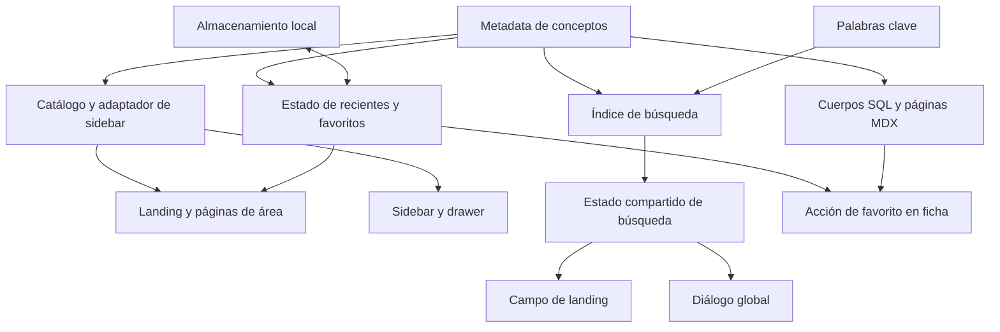

# AllDoc — SDD del rediseño de la landing y la app

**Documento:** especificación funcional y diseño técnico.  
**Fecha:** 12 de noviembre de 2026.  
**Estado:** puntos 1, 2 y 3 completados; continúan pendientes los puntos 4 a 8.

**Alcance:** toda la propuesta de mejora de la landing y la app, sin dividirla en entregas parciales.  
**Base:** Docusaurus, React, TypeScript, MDX, CSS Modules y Webpack.

## 1. Objetivo

AllDoc es una biblioteca personal para recordar rápidamente conceptos que ya se han aprendido y consultar nuevas formas de hacer algo. Abrirla debe conducir directamente a un concepto mediante búsqueda, recientes, favoritos o el catálogo organizado.

El diseño debe reducir la presentación y el esfuerzo de lectura: una definición breve, variantes concretas, código legible y resultados disponibles al pedirlos. La estética conserva el negro puro, los acentos saturados y los logos actuales.

Este SDD abarca buscador protagonista, catálogo directo, jerarquía visual, fichas más limpias, lectura y ampliación del texto, recientes, favoritos, encabezado móvil compacto, adaptación por dispositivo y medición de rendimiento. Los límites y dimensiones propuestos aquí concretan el diseño; no son valores que el usuario haya fijado previamente.

## 2. Punto de partida verificado

| Pieza actual | Fuente | Cambio previsto |
| --- | --- | --- |
| Landing con presentación grande, ejemplo de SELECT, tarjetas de áreas y accesos SQL | [Home](../src/pages/index.tsx) | Sustituir esa composición por búsqueda, accesos personales y catálogo |
| Áreas de estudio | [areas.ts](../src/content/areas.ts) | Conservar las tres áreas y sus rutas |
| Jerarquía de herramientas y grupos | [sidebars.ts](../sidebars.ts) | Compartir su definición con el catálogo de la landing |
| Buscador local en un diálogo, índice diferido y atajo de teclado | [SearchBar](../src/theme/SearchBar/index.tsx), [search.ts](../src/lib/search.ts), [search-index.ts](../src/content/search-index.ts) | Compartir el motor y la carga del índice con la búsqueda de la landing |
| Cinco fichas SQL y ocho ejemplos | [sql.ts](../src/content/sql.ts), [SqlNotes](../src/components/SqlNotes/index.tsx) | Conservar el contenido y simplificar su presentación |
| Contenido y sidebar con desplazamiento separado | [DocRoot/Layout](../src/theme/DocRoot/Layout/index.tsx) | Mantener este comportamiento en el nuevo diseño |
| Encabezado móvil con una segunda fila de áreas | [Navbar/Content](../src/theme/Navbar/Content/index.tsx) | Mostrar el área activa y un selector compacto en el encabezado |
| Colores e iconos existentes | [palettes.ts](../src/content/palettes.ts), [TopicIcon](../src/components/TopicIcon/index.tsx) | Reutilizar opciones, persistencia y archivos actuales |
| Pruebas de búsqueda, paletas, SQL y responsive | [tests](../tests), [playwright.config.ts](../playwright.config.ts) | Ampliar las comprobaciones relacionadas con el rediseño |

Recientes y favoritos son capacidades nuevas. Las secciones distintas de SQL están preparadas, pero todavía no tienen apuntes. Desarrollo web e IA también están sin conceptos.

## 3. Decisiones que se conservan

| ID | Requisito existente |
| --- | --- |
| C-01 | Fondo, paneles y bloques de código en negro puro `#000000`; solo existe modo oscuro |
| C-02 | El selector «Texto» cambia el acento, con colores saturados; azul es la opción inicial |
| C-03 | Se mantiene el resaltado de sintaxis y los logos actuales |
| C-04 | El encabezado permanece visible y estable; la app no tiene footer |
| C-05 | Contenido y sidebar se desplazan por separado, solamente cuando tienen contenido que desbordar; sin arrastre de la página ni rebote entre paneles |
| C-06 | Análisis de datos, Desarrollo web e IA pertenecen al encabezado, fuera de la jerarquía del sidebar |
| C-07 | Los grupos y herramientas empiezan contraídos, incluso SQL si se abre directamente un concepto suyo |
| C-08 | Pulsar SQL u otra categoría solo despliega o contrae; pulsar un concepto navega |
| C-09 | Se conserva el orden y la agrupación actuales. Excel y Power Query siguen separados; Power BI y Tableau también |
| C-10 | Se conservan las rutas de conceptos y los ejemplos de negocio con `productos` |
| C-11 | «Repaso Completo» y «SQL de un vistazo» permanecen eliminados |
| C-12 | La implementación continúa sobre el stack actual. Cuando haga falta actualizar o añadir dependencias se utiliza la última versión estable compatible y se conserva el lockfile |

La propuesta no requiere cambiar a Vite, incorporar un servidor, cuentas o sincronización entre dispositivos. Recientes y favoritos pertenecen al navegador en el que se usan.

## 4. Arquitectura de información

El encabezado ofrece las tres áreas. En la landing se muestra inicialmente Análisis de datos y se permite cambiar el catálogo de área mediante ese mismo selector. Las categorías no tienen rutas de introducción. Las páginas de área existentes siguen siendo accesibles por sus URL y muestran el mismo catálogo para esa área.

En una ficha, cambiar de área desde el encabezado navega a la página de esa área. En la landing, cambiar de área actualiza el catálogo en el mismo lugar, conserva `/` y no registra una visita a un concepto. El área seleccionada en la landing es estado de esa pantalla y no se persiste. En esa pantalla los controles de área actúan como botones de selección con estado anunciado; en las fichas actúan como enlaces de navegación.

```text
Análisis de datos
├─ Excel
├─ Power Query
├─ SQL
│  ├─ SELECT
│  ├─ WHERE
│  ├─ ORDER BY
│  ├─ LIMIT
│  └─ Comentarios
├─ Tablas y archivos
│  ├─ Pandas
│  └─ openpyxl
├─ Cálculo científico
│  ├─ NumPy
│  └─ SciPy
├─ Visualización
│  ├─ Matplotlib
│  └─ Seaborn
├─ Conexiones SQL
│  ├─ SQLAlchemy
│  ├─ sqlite3
│  ├─ mysql-connector-python
│  └─ psycopg
├─ Peticiones y formatos
│  ├─ requests
│  ├─ httpx
│  └─ json
├─ R
├─ Power BI
└─ Tableau

Desarrollo web — Sin apuntes todavía
IA             — Sin apuntes todavía
```

Los recuentos se calculan a partir de conceptos publicados. SQL muestra «5 conceptos»; una herramienta vacía puede desplegar «Sin apuntes todavía» y no simula tener contenido. Las categorías y grupos se pueden abrir de forma independiente, manteniendo su estado mientras se permanece en esa vista. Un nuevo montaje comienza contraído; no se guardan expansiones entre sesiones.

## 5. Landing: acceso directo

### 5.1 Composición

Orden del contenido: pregunta y campo de búsqueda, recientes si existen, favoritos si existen y catálogo del área seleccionada. Se elimina la presentación grande y la vista previa decorativa de SELECT. No es necesario pulsar «Ver apuntes» para encontrar un concepto.

```text
AllDoc     Análisis de datos · Desarrollo web · IA       Buscar    Texto

¿Qué quieres recordar?
[ Buscar un concepto o cómo hacer algo…                         ⌘K ]

Recientes
SELECT · LIMIT · Comentarios

Favoritos
☆ WHERE · ☆ SELECT

Análisis de datos
▸ [logo] Excel
▸ [logo] Power Query
▸ [logo] SQL                                       5 conceptos
▸ [icono] Tablas y archivos                   Pandas · openpyxl
▸ [icono] Cálculo científico                    NumPy · SciPy
…
```

Los accesos personales del esquema son ilustrativos. Una instalación sin historial ni favoritos muestra directamente el catálogo, sin espacios vacíos, ejemplos inventados ni mensajes de bienvenida que haya que cerrar.

### 5.2 Requisitos funcionales

| ID | Comportamiento |
| --- | --- |
| RF-01 | La búsqueda es el primer control principal del contenido; tiene etiqueta accesible, texto de ayuda breve y atajo visible cuando corresponda |
| RF-02 | El catálogo se puede explorar desde la landing con los mismos logos, orden, grupos y reglas de navegación del sidebar |
| RF-03 | Recientes y favoritos permiten abrir directamente un concepto y muestran contexto suficiente para distinguir títulos iguales de distintas herramientas |
| RF-04 | Cambiar el área de la landing sustituye el catálogo y contrae sus categorías; conserva el buscador y los accesos personales globales |

Las filas usan separadores o bordes discretos y sangría para expresar jerarquía. Los nombres de herramientas son la referencia principal; los logos acompañan. Los recuentos y las descripciones breves quedan en un nivel visual secundario. El catálogo no se aloja dentro de otro panel con su propio scroll.

## 6. Búsqueda compartida

### 6.1 Dos superficies, un motor

La landing tiene un `<input type="search">` real y resultados dentro del flujo del contenido. El control del encabezado y `⌘K`/`Ctrl+K` abren el diálogo de búsqueda existente desde cualquier pantalla. Solo existe una instancia del diálogo y un listener global del atajo.

Ambas superficies comparten índice, normalización, clasificación y caché de carga. La consulta puede pasar de la landing al diálogo sin volver a escribirla. Mientras está abierto el diálogo, la landing no presenta una segunda lista activa de resultados. Cerrar conserva la consulta; elegir un resultado cierra el diálogo y limpia la consulta. La búsqueda no cambia automáticamente el área seleccionada hasta que se navega a un concepto.

No se enfoca el campo automáticamente al cargar la página, para evitar abrir el teclado móvil sin intervención del usuario. El índice se solicita al enfocar la búsqueda o al abrir el diálogo; una promesa compartida evita descargas simultáneas. Un fallo permite reintentar, y una carga que termina tras cerrar el diálogo solo alimenta la caché: no vuelve a abrirlo.

### 6.2 Coincidencias y navegación

| ID | Comportamiento |
| --- | --- |
| RF-05 | Buscar por título, descripción, herramienta, área y palabras clave editoriales, sin distinguir mayúsculas ni acentos |
| RF-06 | Reconocer consultas como `select`, `filtrar`, `ordenar`, `limitar`, `comentarios`, `cómo filtrar` y `qué es SELECT` mediante normalización y términos definidos |
| RF-07 | Priorizar título exacto, después prefijo del título y después coincidencias en contexto, descripción o palabras clave; desempatar por orden del catálogo |
| RF-08 | Ofrecer teclado y táctil: flechas para recorrer, Enter para abrir, Tab en orden natural y Esc para cerrar el diálogo |

Se ignoran palabras auxiliares de una lista breve y probada, como «cómo», «qué», «es», «el», «la», «de» y «para». No se eliminan operadores como `--` o `/*`, que sirven para buscar comentarios. Los términos restantes deben coincidir con el índice; no se añade un servicio de IA ni se promete interpretar cualquier frase.

Sin consulta, el diálogo ofrece recientes si existen y, a continuación, conceptos publicados en orden del catálogo, sin duplicados. En la landing, el campo vacío deja visible la composición normal. Con consulta se presenta una lista de resultados bajo el campo; el catálogo y los accesos personales se sustituyen temporalmente por esa lista. Limpiar la búsqueda recupera su vista y sus expansiones previas.

Cada resultado muestra título, herramienta/área y una descripción de una frase. Se presentan hasta diez resultados; si hay más, «Mostrar más resultados» añade diez. El total se anuncia de forma discreta, sin leer cada pulsación al lector de pantalla. La búsqueda actual contiene cinco conceptos.

### 6.3 Estados visibles

| Estado | Presentación y acción |
| --- | --- |
| Cargando | Campo utilizable y «Cargando apuntes…»; conserva lo que se escribe |
| Con resultados | Lista de enlaces; Enter desde el campo abre el primero |
| Sin coincidencias | «No encontré ese concepto» y sugerencias breves como «filtrar» u «ordenar» |
| Solo palabras auxiliares | «Escribe un concepto o una acción» |
| Error de carga | «No pude cargar los apuntes» y botón «Reintentar»; el catálogo sigue disponible al limpiar o cerrar |

Se conserva `<dialog>` con apertura mediante `showModal()`, nombre accesible y cierre visible. Se reutilizan sus semánticas y manejo de foco, sin añadir una segunda trampa de foco. El fondo y los paneles que quedan detrás no deben desplazarse al interactuar con el diálogo. En móvil se ajusta a la altura disponible con el teclado abierto y solo la lista de resultados desborda cuando lo necesita.

## 7. Recientes y favoritos

### 7.1 Recientes

**RF-09.** Una visita se registra cuando una ruta reconocida de concepto está activa. Abrir grupos, previsualizar resultados o visitar una página de área no cuenta como visita. También cuentan una URL directa y la navegación del historial del navegador.

Se guardan los veinte conceptos visitados más recientemente, una sola entrada por concepto. Revisitar mueve la entrada al principio y actualiza su fecha. La landing muestra los seis primeros; «Ver todos los recientes» despliega los restantes en la misma sección, sin una ruta adicional. Se ordenan por fecha descendente, con desempate estable por ID.

El registro se realiza una vez por activación de ruta, después de leer el almacenamiento. Los rerenders y la repetición de efectos en desarrollo no crean duplicados. Recargar puede actualizar la fecha de esa visita, conservando una sola entrada.

### 7.2 Favoritos

**RF-10.** Cada ficha tiene un botón de estrella junto a su título, con nombre «Guardar en favoritos» o «Quitar de favoritos» y `aria-pressed`. El cambio es inmediato, mantiene el foco y no mueve el contenido ni abre un modal.

La landing muestra hasta seis favoritos y un desplegable «Ver todos los favoritos» si hay más. Se conserva el orden en el que fueron guardados; quitar y volver a guardar envía el concepto al final. Cada fila permite abrir la ficha o quitarla mediante controles separados. No se anidan botones dentro de enlaces. Si se quita el elemento enfocado, el foco pasa al siguiente control disponible de esa sección o, si queda vacía, al buscador.

Los favoritos no cambian el orden del catálogo ni crean categorías nuevas en el sidebar.

### 7.3 Persistencia y estados de fallo

| Decisión | Especificación |
| --- | --- |
| Identidad | ID global estable, por ejemplo `analisis-de-datos/sql/select`; no usar el título como clave |
| Recientes | Clave `alldoc-recents-v1`; valor `{version: 1, items: [{conceptId, visitedAt}]}` |
| Favoritos | Clave `alldoc-favorites-v1`; valor `{version: 1, conceptIds: [...]}` |
| Paleta | Mantener `alldoc-palette` y las migraciones existentes |
| Validación | Comprobar versión, forma, IDs conocidos y fechas finitas; eliminar duplicados y aplicar el límite de recientes |
| Datos dañados | Recuperar un estado vacío solo para la clave afectada; no borrar la otra colección ni la paleta |
| Almacenamiento bloqueado o lleno | Continuar en memoria durante la sesión; informar «Guardado en esta sesión» al realizar una acción que no pudo persistirse |
| Otras pestañas | Escuchar `storage` y actualizar la colección afectada; para cambios simultáneos de la misma clave prevalece la última escritura |
| Concepto retirado | No mostrar enlaces inválidos; limpiar referencias desconocidas en la siguiente escritura válida |

El estado inicial de la renderización estática y la primera hidratación es coherente y vacío. Después se leen las colecciones, antes de permitir escrituras de inicialización. Así no se sobrescribe el historial al montar la app. Las colecciones aparecen sin animaciones de entrada; una respuesta local tardía no debe insertar bloques por encima de un campo o resultado con el que el usuario ya esté interactuando. En ese caso su incorporación visual se pospone hasta limpiar la consulta o volver a la landing.

## 8. Fichas: menos envolturas, mejor lectura

### 8.1 Estructura

```text
Análisis de datos / SQL
SELECT                                                 [☆]
Consulta una tabla y elige qué columnas ver.

Todas las columnas
┌──────────────────────────────────────────────────────────┐
│ SELECT * FROM productos;                                 │
│ El asterisco (*) pide todas.                             │
│ ▸ Ver resultado                                  3 filas │
└──────────────────────────────────────────────────────────┘

Columnas concretas
┌──────────────────────────────────────────────────────────┐
│ SELECT nombre, precio FROM productos;                    │
│ Escribe sus nombres separados por comas.                 │
│ ▸ Ver resultado                                  3 filas │
└──────────────────────────────────────────────────────────┘

SELECT elige las columnas. FROM indica la tabla.
```

En contenedores anchos, las dos variantes pueden mostrarse lado a lado; el esquema muestra su orden de lectura. El título de la ficha se renderiza una sola vez. Los ejemplos mantienen un único borde exterior: el bloque de código interior comparte fondo negro y no añade otra tarjeta anidada. Se conserva el control de copiar código.

| ID | Comportamiento |
| --- | --- |
| RF-11 | Presentar definición breve, variantes completas, aclaración y recordatorio; conservar las ocho consultas y sus resultados |
| RF-12 | Mostrar un `<details>` independiente por resultado, cerrado al abrir una ficha; su apertura no altera otro ejemplo ni el sidebar |
| RF-13 | El resultado mantiene tabla semántica, encabezados y descripción accesible; si es ancha, su scroll horizontal se limita a la tabla |
| RF-14 | Mantener anterior/siguiente y los enlaces de navegación existentes, con jerarquía secundaria y alineación con la ficha |

Para SELECT se mantienen `SELECT * FROM productos;` y `SELECT nombre, precio FROM productos;`. Para LIMIT se mantienen `SELECT * FROM productos LIMIT 5;` y `SELECT nombre FROM productos LIMIT 3;`. WHERE, ORDER BY y Comentarios conservan sus ejemplos actuales. FROM se explica dentro de SELECT.

Las tablas son resultados de referencia ya escritos, verificados ejecutando las consultas en las pruebas con SQLite. El rediseño no incorpora un editor o ejecutor SQL al navegador.

### 8.2 Tipografía y densidad

Valores de partida, expresados en unidades relativas y sujetos a validación visual:

| Elemento | Propuesta |
| --- | --- |
| Título principal de landing | Entre `1.75rem` y `2.5rem`, sin ocupar una pantalla de presentación |
| Texto de lectura | `1rem`, interlineado de aproximadamente `1.5` |
| Código | `0.875rem`, interlineado entre `1.5` y `1.6`; sustituye el tamaño actual cercano a `0.78rem` |
| Aclaraciones y metadatos | Desde `0.875rem`, con contraste suficiente |
| Interior de un ejemplo | Entre `0.625rem` y `0.875rem`, evitando relleno duplicado |
| Ancho máximo de lectura | Aproximadamente `49rem`; el catálogo puede aprovechar más ancho |

Se gana compacidad quitando espacio de presentación y bordes anidados. La definición se expresa en una frase y cada variante en el mínimo código necesario; no se eliminan variantes para hacerlas caber. Los títulos y las explicaciones no se recortan con puntos suspensivos.

**RNF-01.** A escala normal, en `1280×800` y `390×844`, las cinco fichas actuales deben mostrar título, definición, todas sus variantes y recordatorio sin scroll vertical, con resultados cerrados. La navegación anterior/siguiente puede quedar después. En `320×568`, horizontal o al ampliar texto se permite scroll: conservar lectura y funcionalidad tiene prioridad sobre encajar todo en una pantalla.

## 9. Sistema visual

**RNF-02.** El negro puro es el fondo de la landing, catálogo, fichas, resultados, menús y código. Los bordes neutros separan elementos; la tipografía crea la mayor parte de la jerarquía. No se introduce una nueva familia tipográfica remota para este rediseño.

El acento elegido se usa en enlaces, foco, selección, iconos de interfaz y palabras clave. Los logos de marca conservan su tratamiento actual; cadenas, números y comentarios mantienen sus colores de sintaxis. Las ocho opciones actuales siguen disponibles: Azul, Violeta, Verde, Ámbar, Cian, Fucsia, Rojo y Blanco.

Los estados de foco y selección deben distinguirse por forma, borde o indicador además del color. Los botones dan respuesta al pulsar; los cambios discretos de color o borde no desplazan elementos. Se respeta `prefers-reduced-motion`. Los desplegables existentes deben seguir finalizando correctamente sus transiciones al reducir movimiento.

## 10. Encabezado y adaptación por dispositivo

### 10.1 Encabezado

En escritorio se conserva una fila con AllDoc, las tres áreas, búsqueda y selector «Texto». En móvil y tablet hasta el límite actual de `996px`, la segunda fila de pestañas se sustituye por un selector del área dentro del encabezado.

```text
Landing móvil:
[ AllDoc ] [ Análisis de datos ▾ ] [ Buscar ] [ Aa ]

Ficha móvil:
[ Menú ]   [ Análisis de datos ▾ ] [ Buscar ] [ Aa ]
```

El selector ofrece las tres áreas. En las fichas, «Menú» abre los temas del área; su parte superior incluye un enlace a AllDoc/inicio. Las áreas permanecen en su selector del encabezado. Los controles de búsqueda y color pueden mostrar solo sus iconos en pantalla estrecha, con nombre accesible. El nombre del área puede ocupar dos líneas dentro de su control.

**RF-15.** El encabezado permanece en su lugar mientras se desplaza contenido. No se oculta, encoge o reaparece por dirección del scroll. La altura objetivo normal es aproximadamente `3.5rem`, más la zona segura del dispositivo; puede crecer para texto ampliado. El layout debe asignarle altura natural y dar el resto del viewport al contenido, sin taparlo con una superposición.

El menú de áreas y el selector de color se cierran con Esc o al elegir una opción y mantienen acceso por teclado. Se conservan los componentes que ya resuelven estos comportamientos. Cualquier API nueva requiere comprobar soporte y una alternativa funcional ligera; no se introduce una dependencia solo para cambiar la apariencia de estos menús.

### 10.2 Reglas de layout

**RNF-03.** El contenedor exterior ocupa la altura visible. Encabezado en una fila de altura automática; el espacio restante se reparte con grid/flex y mínimos de tamaño que permitan encoger los paneles. El lector y el sidebar usan `overflow: auto`; el contenedor exterior no actúa como un tercer scroller.

En escritorio, sidebar y lector conservan el scroll independiente. En móvil, el sidebar pasa al drawer actual; cerrarlo devuelve acceso al lector sin modificar su posición. El contenido no desplaza el menú que está detrás ni al contrario. Un panel sin desbordamiento no muestra una barra ni captura desplazamientos innecesarios.

Las fichas usan container queries para elegir una o dos columnas según el espacio real de su contenedor. Se conserva el cambio de shell/sidebar de Docusaurus alrededor de `996px`/`997px`. Se usan media queries para el dispositivo de entrada y preferencias; la disposición de los componentes depende de su espacio disponible.

| Contexto | Comportamiento |
| --- | --- |
| Celular | Catálogo y ejemplos en una columna, filas táctiles y texto ajustado al ancho |
| iPad vertical | Encabezado compacto y drawer; ejemplos en dos columnas solo si el lector tiene ancho suficiente |
| iPad horizontal / computadora | Sidebar visible desde el umbral actual; ejemplos distribuidos por ancho del lector |
| Rotación | Cambiar entre drawer y sidebar sin dejar overlays, scroll bloqueado o controles fuera de pantalla |
| Teclado en pantalla | Campo de búsqueda, cierre y resultados alcanzables dentro del viewport disponible |
| Zoom o texto al 200% | Reflujo y altura natural de los controles; no ocultar texto para conservar una composición rígida |

Se respetan safe areas y unidades de viewport dinámico, con una altura de respaldo apropiada. El código corto de estos apuntes se ajusta en celular, conservando los saltos de línea significativos. Solo tablas o código cuya estructura lo exija pueden tener scroll horizontal propio; la página no debe desbordar horizontalmente.

## 11. Accesibilidad y compatibilidad

**RNF-04.** Se debe poder completar búsqueda, catálogo, favoritos, selector de área, selector de color y resultados mediante teclado o tacto. El orden de foco sigue el orden visible. Los controles tienen al menos `44×44` CSS px en táctil; los iconos pueden ocupar menos dentro de esa área.

Requisitos verificables:

- Un `h1` por pantalla, niveles de encabezado coherentes y regiones de navegación con nombre.
- Categorías como controles de despliegue con `aria-expanded`; conceptos como enlaces reales. No agregar semántica de `tree` o `menu` si no se implementa su patrón completo de teclado.
- Nombres accesibles para controles que solo muestran iconos y logos decorativos ocultos al lector de pantalla.
- Foco visible, texto normal con contraste mínimo `4.5:1`, e indicadores y componentes con contraste mínimo `3:1` donde corresponda.
- Texto al `200%` sin pérdidas y reflujo a `320` CSS px, manteniendo disponibles controles, código y explicación.
- Ningún bloqueo de zoom mediante la etiqueta viewport. Ninguna altura fija que recorte texto ampliado.
- Cambio de ruta y apertura de diálogo con foco coherente; el foco no se queda en un drawer que ya está cerrado.

Se usarán Chrome/Edge, Firefox y Safari actuales como objetivo funcional, con comprobación de Safari/iOS real cuando sea posible. La suite existente en Chromium comprueba tamaños; no equivale a una prueba en cada sistema operativo. Las APIs opcionales se detectan antes de usarlas. El reflujo y el zoom deben funcionar sin depender de `<meta name="text-scale">`; si se adopta esa mejora, se verifica su interacción con el CSS de Docusaurus y se evita imponer un tamaño raíz que impida el escalado.

## 12. Diseño técnico propuesto

### 12.1 Fuentes de datos

La metadata necesaria para navegar está separada del cuerpo de los apuntes. El catálogo, la navegación de áreas y el índice de búsqueda utilizan esa metadata. Las fuentes de datos de esta sección están implementadas; la sección 12.2 distingue los componentes implementados de los pendientes.

| Archivo | Responsabilidad |
| --- | --- |
| `src/content/concepts.ts` — nuevo | Metadata canónica: ID global, área, herramienta, slug, título, descripción breve, etiqueta y orden |
| `src/content/catalog.ts` — nuevo | Árbol ordenado de áreas, grupos y herramientas; pertenencia de conceptos derivada de su metadata |
| `src/content/sql.ts` — existente | Ejemplos, resultados, recordatorio y nota SQL, vinculados a metadata por ID; conservar una API adaptadora para las páginas MDX |
| `src/content/search-keywords.ts` — nuevo | Palabras clave editoriales por ID; separadas del catálogo mínimo |
| `src/content/search-index.ts` — existente | Índice derivado de metadata más palabras clave, cargado al usar el buscador |
| `sidebars.ts` — existente | Adaptar el catálogo a categorías de Docusaurus y rutas de documentos, manteniendo reglas C-07 a C-09 |

Tipos orientativos:

```ts
type ConceptMeta = {
  id: string; // analisis-de-datos/sql/select
  areaId: AreaId;
  topicId: string;
  slug: string; // /apuntes/analisis-de-datos/sql/select
  title: string;
  label: string;
  description: string;
  order: number;
};

type RecentEntry = {conceptId: string; visitedAt: number};
type RecentState = {version: 1; items: RecentEntry[]};
type FavoriteState = {version: 1; conceptIds: string[]};
```

El ID de metadata es global; los IDs cortos que reciben hoy las fichas SQL pueden resolverse mediante un adaptador. Ningún consumidor construye rutas a partir de títulos. El catálogo, el sidebar y los accesos personales comparten los datos, pero conservan estados de despliegue independientes.



### 12.2 Componentes y estado

| Pieza | Responsabilidad | Estado |
| --- | --- | --- |
| `Catalog` | Renderizar jerarquía compacta, recuentos, categorías y conceptos | Implementado |
| `HomeSearch` | Campo y resultados en el flujo de la landing | Implementado |
| `SearchProvider` | Consulta, superficie activa y carga/caché del índice | Implementado |
| `SearchDialog` | Diálogo nativo único y atajo global | Implementado |
| `SearchResults` | Estados, enlaces, teclado y paginación comunes | Implementado |
| `PersonalLibraryProvider` | Hidratar, validar, actualizar y persistir recientes y favoritos | Implementado |
| `PersonalShortcuts` | Presentar recientes/favoritos y sus expansiones | Implementado |
| `FavoriteButton` | Guardar o quitar un concepto y exponer su estado accesible | Implementado |
| `AreaSwitcher` | Elegir área en el encabezado compacto y conservar las tres opciones | Pendiente |

Se montan los providers una sola vez mediante el wrapper `src/theme/Root.tsx`, compatible con la renderización estática de Docusaurus. Las lecturas de `window`, `localStorage`, teclado y ubicación que lo requieran ocurren en cliente, con limpieza de listeners. Estado local de componentes para resultados desplegados y categorías; no se incorpora una librería global de estado para estas colecciones pequeñas.

Los textos, consultas y tablas siguen siendo contenido editorial versionado. Añadir un concepto requiere metadata y cuerpo; las pruebas comprueban correspondencia entre ambos y su ruta MDX. Una herramienta vacía permanece visible sin inventar una página de concepto.

## 13. Rendimiento: objetivos y medición

**RNF-05.** Antes de implementar se registra una referencia sobre el build de producción actual. Después se repite el mismo recorrido, con igual dispositivo, navegador, red y condiciones de CPU. La velocidad de compilación no sustituye la medición de respuesta de la app.

| Medida | Objetivo de diseño y comprobación |
| --- | --- |
| Respuesta visual a búsqueda, categorías y favorito | Percentil 95 de hasta `100 ms` en el recorrido de laboratorio acordado, con índice cargado; registrar treinta muestras de cada interacción |
| Primera apertura con índice sin caché | Mostrar campo y estado de carga sin esperar a la red; registrar por separado tiempo de carga y tiempo hasta resultados |
| Trabajo del hilo principal | Investigar tareas atribuibles al nuevo código de más de `50 ms` durante escritura y despliegues, usando trazas |
| INP | Referencia de buena respuesta de hasta `200 ms`; si existen muestras de campo suficientes, evaluar el percentil 75 por móvil y escritorio |
| Layout | No mover el encabezado o los ejemplos al cargar logos; reservar sus dimensiones y verificar que el contenido no salta durante una interacción |
| JS y CSS iniciales | Registrar tamaños comprimidos antes/después; identificar y justificar incrementos. El shell no importa cuerpos de fichas ni un nuevo motor de búsqueda pesado |

El objetivo de `100 ms` es un presupuesto propuesto para este proyecto, no una medición ya obtenida ni un umbral oficial de INP. Una prueba local y sus percentiles tampoco demuestran el INP de usuarios reales. No se declara «sin lag» sin acompañarlo de condiciones y resultados medidos.

Procedimiento reproducible: build de producción, una pasada con caché fría y otra con índice cargado; recorridos en computadora y emulación móvil con CPU limitada `4×`. Registrar hardware, versión del navegador y perfil de red, y repetir en un teléfono real cuando esté disponible. Medir apertura, escritura, navegación por resultados, despliegue de categorías y guardar/quitar favoritos. Para diagnosticar INP distinguir espera de entrada, ejecución y presentación.

No se instala telemetría externa ni se envían búsquedas o historial. Se usan las herramientas del navegador y resultados locales. Si hace falta calcular INP de manera automatizada, evaluar la librería oficial `web-vitals` como herramienta de diagnóstico, sin incluirla incondicionalmente en el runtime.

Se mantienen datos locales pequeños, un índice cargado una vez y cadenas normalizadas preparadas al cargarlo. No se añade debounce que retrase la escritura por defecto. No se introduce virtualización, workers o dependencias para cinco conceptos; cualquier optimización adicional responde a una traza que muestre el problema. Como comprobación de crecimiento, probar el motor con mil entradas sintéticas, separando ese resultado del catálogo real.

## 14. Verificación y criterios de aceptación

**RNF-06.** La validación combina pruebas de lógica, navegación real, capturas y revisión manual. Las nuevas referencias visuales se generan después de revisar el diseño; se mantiene la tolerancia actual de `0.001`. No se amplía para ocultar diferencias.

### 14.1 Matriz responsive

| Proyecto actual | Viewport |
| --- | --- |
| celular-pequeno | `320×568` |
| celular | `390×844` |
| celular-horizontal | `844×390` |
| ipad | `768×1024` |
| ipad-horizontal | `1024×768` |
| laptop | `1280×800` |
| escritorio | `1920×1080` |

Se conservan los siete tamaños de [Playwright](../playwright.config.ts). Añadir verificaciones funcionales en Firefox y WebKit cuando sus ejecutables estén disponibles; las capturas base continúan separadas por entorno y no se comparan entre distintos motores. La comprobación de texto al 200%, zoom y teclado móvil se complementa con revisión en navegador/dispositivo real.

### 14.2 Aceptación trazable

| ID | Criterio observable | Referencia | Verificación |
| --- | --- | --- | --- |
| CA-01 | Primer acceso: buscador y catálogo visibles, sin recientes ni favoritos ficticios ni huecos reservados | RF-01 a RF-03 | E2E y captura con almacenamiento vacío |
| CA-02 | Landing y sidebar conservan las 19 herramientas, sus cinco grupos y el orden documentado | RF-02, C-09 | Prueba del catálogo y E2E |
| CA-03 | Al montar una vista, todos sus grupos y herramientas están contraídos; SQL también al abrir `/sql/where` | C-07 | E2E en URL directa y recarga |
| CA-04 | Pulsar SQL solo cambia su despliegue; pulsar WHERE abre su ruta y cierra el drawer móvil | C-08 | E2E en siete tamaños |
| CA-05 | Cambiar área en landing conserva `/`, actualiza catálogo y mantiene buscador/accesos personales | RF-04 | E2E |
| CA-06 | `filtrar`, `CÓMO FILTRAR` y `qué es SELECT` encuentran los conceptos esperados; `--` encuentra Comentarios | RF-05 a RF-07 | Pruebas del motor y E2E |
| CA-07 | Búsqueda exacta, por prefijo y por términos conserva clasificación y desempates estables | RF-07 | Pruebas de lógica |
| CA-08 | Encabezado, campo y atajo usan un índice compartido y nunca abren dos diálogos | RF-08, sección 6 | E2E y comprobación de solicitudes |
| CA-09 | Error, reintento, lista vacía y carga tardía no rompen navegación ni reabren el diálogo cerrado | Sección 6.3 | E2E con carga interceptada |
| CA-10 | Visitar y revisitar conceptos produce recientes sin duplicados, ordenados y limitados a veinte | RF-09 | Pruebas de lógica y persistencia |
| CA-11 | Guardar/quitar favorito actualiza ficha y landing, persiste al recargar y conserva foco útil | RF-10 | E2E por teclado y táctil |
| CA-12 | Datos corruptos, IDs desconocidos y almacenamiento bloqueado no impiden leer o navegar | Sección 7.3 | Pruebas de lógica y E2E |
| CA-13 | Una pestaña refleja cambios válidos de otra; modificar favoritos no sobrescribe recientes o paleta | Sección 7.3 | E2E con dos páginas del mismo contexto |
| CA-14 | SELECT, WHERE, ORDER BY, LIMIT y Comentarios conservan las ocho consultas y resultados correctos | RF-11, C-10 | Suite SQL con SQLite |
| CA-15 | Una sola envoltura por ejemplo, copia de código disponible, resultados inicialmente cerrados e independientes | RF-11 a RF-13 | Capturas y E2E |
| CA-16 | Contenido esencial de las cinco fichas cabe en los tamaños definidos a escala normal; con texto ampliado sigue accesible | RNF-01, RNF-04 | Medición de bounds y revisión visual |
| CA-17 | Negro puro y ocho acentos persisten; sintaxis, texto y foco conservan legibilidad | C-01 a C-03, RNF-02 | Pruebas de color, contraste y capturas |
| CA-18 | Encabezado estable y compacto, selector móvil de áreas accesible y ausencia de footer | RF-15, C-04, C-06 | E2E y capturas |
| CA-19 | Lector y sidebar no arrastran el otro panel ni la página al llegar a sus extremos; sin overflow, no hay scroll artificial | C-05, RNF-03 | E2E con wheel y revisión táctil |
| CA-20 | Rotación y teclado en pantalla no dejan controles tapados, overlays residuales o scroll bloqueado | Sección 10 | E2E de resize y revisión real |
| CA-21 | Sin desbordamiento de página a 320px; teclado, foco, texto al 200% y movimiento reducido funcionan | RNF-04 | E2E y revisión manual |
| CA-22 | Metadata, catálogo, búsqueda y rutas concuerdan sin IDs repetidos o enlaces rotos | Sección 12 | Pruebas de datos y build |
| CA-23 | Se entregan referencia y medición posterior comparables; la respuesta visual con índice cargado cumple el presupuesto local de p95 de hasta 100 ms y los desvíos restantes se identifican como pendientes | RNF-05 | Informe local de rendimiento |
| CA-24 | «Repaso Completo» y «SQL de un vistazo» no aparecen en landing, catálogo, buscador o rutas publicadas | C-11 | Verificación de datos, build y E2E |
| CA-25 | Anterior/siguiente sigue abriendo el concepto correcto, con acceso por teclado y alineación con la ficha | RF-14 | E2E y revisión visual |

### 14.3 Pruebas y evidencias

Ampliar las pruebas de búsqueda para las consultas nuevas y el índice normalizado. Añadir pruebas para catálogo, IDs, orden, recuentos y enlace a documentos; y para normalización, límite, deduplicación y validación de las colecciones personales. Conservar la ejecución real de los ocho ejemplos SQL y las pruebas de paleta.

Las capturas cubren landing vacía, landing con accesos personales, catálogo expandido, ficha SELECT, ficha Comentarios, búsqueda con resultados y encabezado móvil con selector de área. Usar datos y fechas fijas, logos decodificados, expansiones terminadas, foco y scroll en posiciones conocidas; estas condiciones evitan repetir la inestabilidad ya observada en capturas del menú.

Comandos existentes para validar la implementación:

```sh
npm test
npm run typecheck
npm run typecheck:tests
npm run build
npm run test:ui
```

`npm run test:ui:update` se usa para registrar cambios visuales intencionados después de revisarlos. La suite UI compila y sirve en su puerto propio, sin interferir con el servidor de desarrollo. Si un entorno no puede ejecutar un navegador, registrar esa limitación y obtener la ejecución en un entorno que sí pueda; un resultado omitido no cuenta como aprobado.

## 15. Trabajo necesario para implementar el alcance completo

Las siguientes tareas expresan dependencias técnicas; todas forman parte del mismo alcance de este SDD.

Por indicación del usuario, desde el punto 6 los cambios se desarrollan con TDD:
prueba del comportamiento antes de la implementación, ejecución para comprobar
el fallo esperado, implementación mínima, paso a verde y refactorización con las
pruebas aprobadas. Se registra la evidencia roja y verde. Un fallo del entorno o
de configuración no cuenta como fase roja; debe fallar la expectativa funcional
que motiva el cambio. Las capturas complementan las aserciones, sin sustituirlas.

| Orden | Trabajo | Resultado verificable |
| --- | --- | --- |
| 1 | Registrar capturas, tamaños de bundle y tiempos de referencia | Completado: [referencia verificada](../benchmarks/runs/2026-11-13T05-50-13-968Z-543ae4e484/README.md) para la comparación de CA-23 |
| 2 | Introducir metadata canónica y catálogo compartido; adaptar SQL, búsqueda y sidebar | Completado: [verificación](verification/point-2.md) de rutas, contenido, jerarquía y fuentes de datos |
| 3 | Compartir carga/estado de búsqueda y añadir campo de landing con todos sus estados | Completado: [verificación](verification/point-3.md) de CA-06 a CA-09 |
| 4 | Implementar colecciones locales, registro de visitas, accesos y botón de favorito | Completado: [verificación](verification/point-4.md) de CA-10 a CA-13 |
| 5 | Componer landing y páginas de área con jerarquía compacta | Completado: [verificación](verification/point-5.md) de CA-01, CA-04 y CA-05 |
| 6 | Simplificar fichas y ajustar tipografía, envolturas y resultados | Completado con TDD: [verificación](verification/point-6.md) de CA-14 a CA-17 y CA-25 |
| 7 | Compactar encabezado móvil y adaptar componentes sin alterar paneles independientes | CA-18 a CA-21 |
| 8 | Ejecutar verificación, revisar imágenes, medir y corregir regresiones | CA-01 a CA-25, informe de resultados y limitaciones reales |

### Registro del punto 1

Se implementó `npm run baseline` y se documentó su procedimiento en [benchmarks/README.md](../benchmarks/README.md). La [ejecución completa](../benchmarks/runs/2026-11-13T05-50-13-968Z-543ae4e484/README.md) registra el build de producción, tamaños comprimidos, huella de fuente y entorno, 42 capturas nuevas en siete tamaños y 240 muestras de interacciones en laptop y celular emulado. También conserva dos primeras aperturas del buscador y 35 referencias visuales anteriores, con su procedencia explícita.

La captura se ejecutó desde la terminal del usuario y se revisó en el workspace. Se comprobaron hashes, dimensiones, integridad de las muestras y las seis vistas de cada tamaño. [Revisión de evidencia y límites](../benchmarks/runs/2026-11-13T05-50-13-968Z-543ae4e484/review.md). El punto 1 está completo; CA-23 requiere además comparar con la implementación posterior del rediseño.

### Registro del punto 2

Se implementaron la metadata de conceptos con IDs globales y el catálogo de las tres áreas, las 19 herramientas y los cinco grupos actuales. El sidebar y el índice de búsqueda derivan de ese catálogo. Los títulos, descripciones y rutas de las fichas se definen una sola vez; Docusaurus los recibe mediante su parser de frontmatter. Los ejemplos y resultados SQL permanecen separados y las páginas existentes conservan sus IDs cortos mediante un adaptador.

Pasaron 28 pruebas, ambos chequeos de tipos y el build de producción. Las diez rutas mantienen el mismo HTML renderizado tras normalizar scripts y referencias a bundles; las ocho consultas, sus resultados y palabras clave coinciden con el estado previo. El cuerpo de las fichas SQL se sirve desde un chunk compartido de las páginas de apuntes. [Evidencia y alcance de la verificación](verification/point-2.md).

### Registro del punto 3

La portada incorpora un campo real de búsqueda y comparte consulta, índice y caché con el diálogo del encabezado. Existe un único diálogo nativo y un atajo global. El índice se solicita al enfocar o abrir, comparte una promesa mientras carga y puede reintentarse tras un fallo. Se conserva la consulta al cerrar y se limpia al elegir un resultado. Se incluyeron las consultas con palabras auxiliares, ranking, resultados en lotes de diez, estados de carga/vacío/error y navegación por teclado compatible con composición de texto.

Pasaron 35 pruebas de código, ambos chequeos de tipos y el build. La ejecución de navegador, realizada desde la terminal del usuario, terminó con 99 aprobadas y seis omisiones previstas, sin fallos ni pruebas inestables. Se revisaron las 21 capturas de portada, búsqueda en portada y diálogo en los siete tamaños. [Verificación y límites](verification/point-3.md).

### Registro del punto 4

Se añadieron recientes y favoritos con claves locales independientes y versionadas, registro por activación de rutas reconocidas y sincronización entre pestañas. La estrella de cada ficha conserva foco y posición; la portada ofrece accesos a las dos colecciones y permite quitar favoritos con foco útil. El buscador sin consulta sugiere primero los recientes, sin duplicar conceptos ni alterar el ranking de las consultas. Los datos dañados o el guardado bloqueado/lleno no impiden usar la biblioteca.

Pasaron 49 pruebas de código, incluidos dos casos con el preset cliente real, ambos chequeos de tipos y el build. La ejecución de navegador terminó con 148 aprobadas y seis omisiones previstas, sin fallos ni pruebas inestables. Se revisaron 14 capturas de ficha y colecciones en siete tamaños. [Verificación y límites](verification/point-4.md).

### Registro del punto 5

La portada presenta buscador, accesos personales y catálogo del área seleccionada, con las 19 herramientas, cinco grupos y logos actuales. Grupos y herramientas usan desplegables nativos independientes y empiezan cerrados. SQL despliega sus conceptos y solo los enlaces de conceptos navegan. Las páginas de área comparten el catálogo; Desarrollo web e IA conservan su estado vacío.

Las áreas del encabezado seleccionan el catálogo en la portada sin abandonar `/`, conservando consulta y accesos globales. Cambiar de área contrae sus categorías; buscar y limpiar recupera las expansiones previas. Fuera de la portada, los controles de área siguen navegando. El catálogo adapta su jerarquía al ancho disponible y no crea otro panel de scroll.

Pasaron las 49 pruebas de código, ambos chequeos de tipos y el build. El HTML estático conserva un título principal por página y catálogos inicialmente cerrados. La ejecución de navegador terminó con 176 aprobadas y seis omisiones previstas, sin fallos ni inestables. Se revisaron 21 capturas en siete tamaños. [Verificación y límites](verification/point-5.md).

### Registro del punto 6

Se desarrolló con TDD: seis casos nuevos escritos antes de modificar la aplicación y fallo funcional registrado sobre la misma huella del punto 5. El código interior de SELECT tenía cuatro bordes de 1 px, frente a los 0 px exigidos para una envoltura única. Después se retiraron el borde y el relleno duplicados, se ajustó código y aclaraciones a 0.875 rem y se adaptaron los ejemplos al ancho del contenedor.

Las ocho consultas y sus resultados se conservan. Los resultados permanecen cerrados e independientes, con tablas semánticas y regiones de scroll con nombre y teclado. Se verifica copia real, rutas y alineación de anterior/siguiente, texto ampliado y las ocho paletas. Las cinco fichas muestran su contenido esencial sin scroll en 390×844 y 1280×800.

Pasaron 49 pruebas de código, ambos chequeos de tipos y el build. La fase verde de navegador terminó con 218 aprobadas y seis omisiones previstas, sin fallos ni inestables; se revisaron 21 capturas en siete tamaños. [Evidencia roja/verde, verificación y límites](verification/point-6.md).

Al 200% quedan solapamientos del encabezado y ajuste excesivo de etiquetas del sidebar en ciertas anchuras. Se registran para el punto 7; CA-18 a CA-21 siguen pendientes y este registro no acredita la accesibilidad global del shell.

La implementación completa del rediseño requiere la evidencia de los puntos restantes. Los registros anteriores acreditan el alcance concreto de los puntos 1 a 6.

## 16. Guías y fundamentos utilizados

Se consultó la copia local de [Modern Web Guidance](../tmp/modern-web-guidance/skills/modern-web-guidance/SKILL.md). Las reglas se adaptan a las preferencias explícitas del usuario y al shell existente; no se adoptan APIs nuevas solo por estar mencionadas en una guía.

| Guía local | Regla concreta | Aplicación en el diseño |
| --- | --- | --- |
| [content-first-noise-reduction](../tmp/modern-web-guidance/skills/modern-web-guidance/guides/user-experience/content-first-noise-reduction.md) | “Don't move content while the user reads.” | Quitar presentación grande, reservar dimensiones, resultados bajo demanda y evitar inserciones sobre una interacción activa |
| [form-factor-adaptation](../tmp/modern-web-guidance/skills/modern-web-guidance/guides/user-experience/form-factor-adaptation.md) | “Use container queries instead of viewport-width media queries for component layout” | Variantes según ancho del lector, controles táctiles y zonas seguras |
| [respect-os-text-scale](../tmp/modern-web-guidance/skills/modern-web-guidance/guides/accessibility/respect-os-text-scale.md) | “Test that text can be resized to at least 200%” | Unidades relativas, altura natural y pruebas de ampliación/reflujo |
| [dialog](../tmp/modern-web-guidance/skills/modern-web-guidance/guides/ui-components/dialog.md) | “Use the native `<dialog>` element” | Conservar el diálogo global y sus semánticas, sin reconstruir otra trampa de foco |
| [identify-inp-causes](../tmp/modern-web-guidance/skills/modern-web-guidance/guides/performance/identify-inp-causes.md) | “use INP subparts initially” | Medir espera, ejecución y presentación antes de elegir una optimización |

La sugerencia de ocultar barras al hacer scroll de la primera guía no se aplica: el usuario pidió un encabezado fijo. Sus recomendaciones de analítica tampoco añaden autorización para enviar datos; la medición prevista aquí es local.

El objetivo de INP de hasta `200 ms` y su evaluación por percentil 75 proceden de [web.dev: Interaction to Next Paint](https://web.dev/articles/inp). La ampliación al `200%` y el reflujo a `320` CSS px se apoyan en [W3C: Resize Text](https://www.w3.org/WAI/WCAG22/Understanding/resize-text.html) y [W3C: Reflow](https://www.w3.org/WAI/WCAG22/Understanding/reflow.html). Estos criterios orientan verificaciones concretas; este documento no certifica conformidad de accesibilidad de toda la aplicación.
