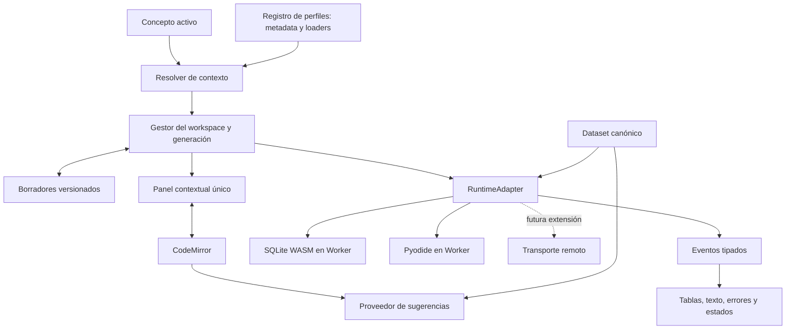

# AllDoc — SDD del panel de práctica contextual

**Fecha:** 13 de noviembre de 2026, America/Mexico_City.  
**Estado:** puntos 1 a 6 completados; puntos 7 y 8 pendientes.
**Objetivo de esta etapa:** validar la estructura y el contrato con SQL y pandas, para incorporar después más lenguajes, librerías y frameworks.  
**Base:** [SDD del rediseño](alldoc-sdd.md), cuyos ocho puntos están completados. Este documento define una ampliación y conserva su evidencia histórica.

Los puntos 1 a 6 implementan y verifican el panel con SQLite y Pyodide/pandas reales. La aceptación global y sus presupuestos de rendimiento permanecen en el punto 8. Están publicadas y verificadas las cinco fichas SQL y el miniapunte DataFrame de pandas; el punto 2 conserva su evidencia de datos, UI y tamaños.

## 1. Resultado esperado

Mientras se consulta un apunte, un control discreto permite abrir o colapsar un panel de práctica sin abandonar la página. El panel conoce la herramienta del apunte: SQL utiliza un editor SQL con sus tablas; pandas utiliza Python con pandas y datos preparados. Cambiar de herramienta cambia ese contexto y recupera el borrador correspondiente.

La primera validación cubre dos perfiles reales, no un soporte universal simulado:

| Perfil | Lenguaje | Ejecución | Datos iniciales | Resultado |
| --- | --- | --- | --- | --- |
| SQL / SQLite | SQL, dialecto SQLite | SQLite WASM en Worker | `productos-basico@1` | Tablas y mensajes del motor |
| pandas | Python con pandas | Pyodide en Worker | El mismo paquete de productos | DataFrames, texto y errores |

Se añadió un miniapunte de pandas para validar después el cambio de contexto desde una ficha real. No habrá una página de práctica adicional ni un enlace especial dentro de una categoría vacía para resolver este caso.

El contrato contempla otros motores y salidas. Añadir R, Rust, React o una librería adicional será un trabajo posterior de adaptador, capacidades y pruebas; no exigirá rehacer el panel. La conclusión de esta etapa no acreditará su ejecución.

## 2. Restricciones que se conservan

| ID | Restricción |
| --- | --- |
| PC-01 | Negro puro, modo oscuro único, ocho acentos saturados, logos y resaltado de sintaxis existentes |
| PC-02 | Encabezado estable, ausencia de footer y scroll independiente de lector y sidebar |
| PC-03 | Las categorías solo despliegan; los enlaces de conceptos navegan. Orden y agrupación actuales conservados |
| PC-04 | Búsqueda, recientes y favoritos mantienen su comportamiento y sus claves de almacenamiento |
| PC-05 | Las ocho consultas y los resultados SQL actuales permanecen iguales; el editor añade práctica sin reemplazar su resultado editorial |
| PC-06 | Las fichas siguen siendo compactas. Editor y motores se cargan al abrir práctica, sin convertir cada ejemplo en un editor activo |
| PC-07 | React, Docusaurus, TypeScript, MDX, Webpack y CSS Modules siguen siendo el stack de la app |
| PC-08 | Desarrollo con TDD para todo cambio de comportamiento; pruebas reales de los motores además de dobles de prueba del contrato |
| PC-09 | Al implementar se seleccionan las últimas versiones estables compatibles, se actualiza el lockfile y se registra el entorno reproducible |

Un Worker evita bloquear la interfaz, pero no constituye por sí solo una frontera de seguridad. La ejecución de código tiene también el aislamiento descrito en la sección 13.

En el punto 4 se separan `editorAvailability` y `availability`: SQL y pandas
tienen editor habilitado y runtime pendiente. Sus controles permiten escribir,
guardar y consultar datos, pero «Ejecutar» permanece desactivado y lo explica.
La edición no instala un motor ficticio ni convierte un perfil futuro en uno
habilitado. Las fases 5 y 6 añadirán las implementaciones reales.

## 3. Alcance actual y ampliaciones

### 3.1 Entrega verificable actual

- Panel contextual único con apertura, colapso, cambio de herramienta y disposición responsive.
- Editor CodeMirror 6 y contratos independientes de edición, ejecución, sugerencias y datos.
- Un adaptador SQL real y uno Python/pandas real; ambos ejecutados en el navegador.
- Datos comunes reproducibles, inspección de su estructura y restauración separada de código y entorno.
- Autocompletado SQL basado en el esquema y autocompletado Python/pandas con un proveedor explícito.
- Borradores locales por contexto, errores, cancelación y rechazo de respuestas obsoletas.
- Un miniapunte de pandas y acciones para llevar ejemplos al panel.
- Pruebas del contrato, integración real, UI, accesibilidad y medición separada de carga y uso.

### 3.2 Extensiones previstas, fuera de la implementación actual

| Tecnología | Adaptador previsto | Dependencia de servidor de ejecución |
| --- | --- | --- |
| NumPy, SciPy, Matplotlib, Seaborn y openpyxl | Perfiles adicionales sobre Python, con paquetes y salidas comprobados | Según compatibilidad del paquete con Pyodide |
| `json`, `sqlite3`, SQLAlchemy | Python; JSON o SQLite local según perfil | No por principio; SQLAlchemy depende del motor utilizado |
| R | WebR, con paquetes compatibles | No para la ejecución compatible en navegador |
| HTML, CSS, JS, TS y React | Adaptador web con Sandpack y vista previa aislada | Sin backend propio para los ejemplos compatibles; puede usar servicios de distribución de dependencias |
| PostgreSQL local de práctica | Adaptador PGlite | No por principio |
| Rust | Compilador remoto y servicio de lenguaje `rust-analyzer` | Sí en la arquitectura propuesta |
| `mysql-connector-python` y `psycopg` contra bases tradicionales | Python remoto y base de práctica aislada | Sí, para ese entorno y sus conexiones habituales |
| `requests` y `httpx` | Python con capacidades HTTP declaradas | Según CORS, API y necesidad de credenciales privadas |
| Excel, Power Query, Power BI y Tableau | Integraciones específicas o motores de práctica por definir | Evaluación propia; disponer de un servidor no reproduce estos productos |

La tabla expresa vías de extensión, no compatibilidad validada. Cada perfil futuro deberá declarar sus límites y superar sus pruebas. En particular, colorear Python no acredita pandas, ni colorear Rust acredita compilación o autocompletado semántico.

No se implementan ahora backend, cuentas, sincronización entre dispositivos, ejecución de modelos de IA, instalaciones arbitrarias de paquetes, importación de archivos del usuario ni un playground global. La forma de archivos virtuales y resultados admite ampliarlos después. Estas exclusiones delimitan esta validación, no cierran la arquitectura a esos usos.

## 4. Comportamiento del panel

### 4.1 Entrada y contexto

**PF-01.** Un control con nombre «Practicar SQL» o «Practicar pandas» está disponible mientras se consulta un concepto de un perfil habilitado. Se ubica en un borde del área lectora, accesible sin volver al principio del apunte. Es un control compacto de al menos 44×44 CSS px, no una barra de footer ni una nueva sección del sidebar. Se reserva espacio para que no tape el último enlace o texto.

**PF-02.** El contexto se resuelve desde la metadata canónica del concepto y su herramienta, no desde el título visible ni desde el último desplegable pulsado. Abrir una categoría no cambia el contexto. La portada y las páginas de área no activan un entorno de práctica.

**PF-03.** Hay un solo panel y un solo editor activo. Al iniciar la app está colapsado. Durante la navegación de la sesión recuerda la intención de apertura: fuera de un contexto válido se oculta y libera o suspende recursos; al volver a una herramienta habilitada recupera esa intención. Una recarga completa empieza colapsada y conserva los borradores.

**PF-04.** Cambiar entre SELECT y WHERE mantiene el código, datos y resultados de la sesión SQL mientras el entorno siga vivo. Cambiar SQL → pandas guarda el borrador SQL, cambia perfil y recupera el borrador pandas. No copia SQL a Python ni ejecuta código automáticamente.

El identificador estable de herramienta es `areaId/topicId`; un mismo lenguaje puede corresponder a varias herramientas. El borrador de pandas no se comparte automáticamente con NumPy por ser ambos Python.

### 4.2 Ejemplos y edición libre

**PF-05.** Cada ejemplo compatible ofrece «Probar este ejemplo». La acción abre el panel y prepara su código y dataset. Los ejemplos reciben IDs estables; su título o posición no se usan como identidad.

Si el contexto no tiene borrador, abrir «Practicar» prepara el ejemplo inicial del perfil. Si ya existe uno, lo recupera. Navegar entre conceptos no reemplaza ese borrador.

«Probar este ejemplo» es una sustitución explícita del código actual, pero conserva una revisión anterior recuperable con «Recuperar código anterior». No genera un modal de confirmación por cada ejemplo. Un dataset diferente restaura primero su propio contexto; no mezcla tablas incompatibles ni borra otro borrador.

**PF-06.** El editor permite escribir libremente, ejecutar, detener, restaurar código inicial y reiniciar el entorno. La ejecución se inicia exclusivamente con «Ejecutar» o el atajo del panel. No hay ejecución al escribir, navegar, recuperar un borrador o terminar una descarga.

### 4.3 Persistencia y memoria

| Elemento | Regla |
| --- | --- |
| Borrador | Archivos, archivo activo y selección de dataset, por herramienta/perfil/dataset-versionado |
| Documento en memoria | Se actualiza inmediatamente al escribir; no espera a IndexedDB |
| Persistencia | IndexedDB versionado, escrituras agrupadas; al cambiar de contexto se encola la última revisión antes de desechar su vista |
| Almacenamiento bloqueado o lleno | Continuar en memoria y anunciar «Guardado en esta sesión»; conservar la app y los otros almacenes |
| Entorno de ejecución | Estado temporal; no se promete serializar el heap de Python ni sus variables al recargar |
| Resultados | Último resultado acotado en memoria, asociado a la revisión ejecutada; no se persiste stdout masivo |
| Reinicio del entorno | Reconstruye datos iniciales y variables de preparación, conserva el código del editor |
| Restaurar código | Cambia el borrador por el ejemplo inicial, conserva los datos mutados hasta un reinicio explícito |
| Dos pestañas | Sin sincronización activa de práctica en esta etapa; documentos versionados, detección de revisión más reciente y copia recuperable ante conflicto |

**PF-07.** Clave lógica del workspace: herramienta + perfil + dataset y versión. El borrador registra por separado las versiones de runtime y dependencias con las que se guardó. Una actualización no borra el texto ni cambia silenciosamente el dataset. No se escriben las claves existentes de recientes, favoritos o paleta.

Mantener un solo motor pesado activo es la política inicial. Al colapsar, puede retenerse durante 60 segundos de inactividad; al cambiar de herramienta se libera antes de cargar el otro si lo exige la memoria. El límite es propuesto y se valida en móvil. Descargar el motor de memoria no elimina el borrador, pero puede perder el estado ejecutable; la interfaz lo anuncia al reconstruirlo.

## 5. Miniapunte de pandas

**Concepto publicado:** DataFrame.
**ID:** `analisis-de-datos/pandas/dataframe`.  
**Ruta:** `/apuntes/analisis-de-datos/pandas/dataframe`.  
**Definición:** «Un DataFrame es una tabla: columnas para cada dato y filas para cada producto».

Un solo ejemplo, con resultado inicialmente cerrado:

```python
import pandas as pd

productos = pd.DataFrame({
    "nombre": ["Teclado", "Mouse", "Monitor"],
    "categoria": ["Accesorios", "Accesorios", "Pantallas"],
    "precio": [500, 250, 3500],
})
productos
```

**Aclaración:** «Cada lista forma una columna». **Recordatorio:** «DataFrame organiza tus datos en filas y columnas». El resultado muestra los tres productos, con precio numérico e índice de filas identificado como índice, no como una columna de negocio añadida.

El ejemplo permite validar Python, una librería, tablas y cambio de contexto sin crear un curso. La representación anterior y el dataset canónico deben comprobarse entre sí para impedir que el ejemplo y los datos diverjan.

Pandas permanece en «Tablas y archivos», junto a openpyxl. Pulsar Pandas solo despliega; pulsar DataFrame abre la ficha. El catálogo tiene seis conceptos publicados, de los que SQL conserva cinco. Los recuentos y el índice siguen derivándose de metadata.

## 6. Datos de práctica

**PF-08.** La primera validación usa `productos-basico@1`, extraído de la tabla actual, con tres columnas y tres filas:

| nombre: texto | categoria: texto | precio: entero |
| --- | --- | ---: |
| Teclado | Accesorios | 500 |
| Mouse | Accesorios | 250 |
| Monitor | Pantallas | 3500 |

No se añade un `id` a esta tabla: alteraría los resultados actuales de `SELECT *`. Los datos canónicos conservan tipos; las cadenas de presentación de las fichas no obligan a almacenar precios como texto en los motores.

Un manifiesto pequeño contiene ID, versión, nombres, columnas y tipos para mostrar ayuda. Las filas se cargan bajo demanda. Un proveedor de datos materializa el mismo paquete como tabla SQLite o DataFrame; el esquema para sugerencias deriva de esa definición, no de otra copia manual.

El panel «Datos» muestra tablas o variables preparadas, columnas, tipos y una vista previa acotada. Debe permitir reconocer qué se puede consultar antes de escribir una línea. El ejemplo pandas puede reconstruir `productos`; los experimentos libres pueden usar el DataFrame que prepara el entorno.

**PF-09.** Cada sesión parte de una copia propia de los datos. Cambios SQL como UPDATE o DROP y cambios de un DataFrame no mutan el paquete publicado ni los resultados editoriales. Reiniciar reconstruye la copia de esa sesión; no afecta a otro workspace o pestaña.

El contrato permite datasets posteriores como negocio con clientes, pedidos y detalle, o CSV/XLSX/JSON generados desde una misma fuente. Esos paquetes, importadores y formatos adicionales no son necesarios para dar por validada esta etapa.

## 7. Editor y autocompletado

### 7.1 Editor

CodeMirror 6 se integra mediante un componente propio pequeño. Se usa su API modular y se cargan lenguaje, tema y extensiones del perfil activo. Se conserva el negro y se deriva el acento de la misma paleta de AllDoc. Monaco queda como alternativa descartada para esta etapa por el soporte móvil oficial que declara su proyecto; no se afirma una diferencia de rendimiento sin medirla.

El editor recibe archivos virtuales, cambios y selecciones; no conoce cómo ejecutar Python o SQL. El contrato admite varios archivos para futuros frameworks, aunque la primera UI trabaja con `consulta.sql` o `main.py`. Un cambio de acento no remonta el editor ni borra historial o selección.

### 7.2 Sugerencias por perfil

SQL completa palabras, tablas y columnas del esquema inspeccionado en SQLite.
Python conserva las sugerencias básicas de CodeMirror e incorpora Jedi y las
columnas registradas por el motor. El punto 6 supera sus 63 casos específicos
en los siete tamaños y la comparación independiente de la suite completa. El registro
separa explícitamente poder editar de poder ejecutar y la UI anuncia cuándo
el análisis se pausa durante una ejecución.

**PF-10.** El autocompletado se anuncia con su alcance real. Se separan resaltado, sugerencias y diagnósticos.

| Perfil actual | Proveedor | Comportamiento verificable |
| --- | --- | --- |
| SQL | Extensión SQL de CodeMirror y esquema del motor | Sugiere palabras clave, `productos` y columnas en el contexto correspondiente; el dialecto es SQLite |
| pandas / Python | Jedi en el entorno compatible más proveedor de datos | Sugiere `pd.DataFrame`, funciones o atributos conocidos y columnas de los DataFrames registrados en posiciones compatibles |

El proveedor de columnas es específico de datos; no se atribuye esa capacidad automáticamente a Jedi. Se define y prueba qué formas admite inicialmente, por ejemplo `productos["..."]`. No se promete inferir el esquema de cualquier programa Python sin ejecutarlo.

El esquema SQL se actualiza desde el motor después de ejecutar, también si una ejecución dejó cambios parciales. No se deducen CREATE o DROP mediante expresiones regulares. Python inspecciona los DataFrames presentes en el namespace después de ejecutar; las columnas nuevas y variables eliminadas se reflejan en Datos y en las sugerencias declaradas.

**PF-11.** Las solicitudes incluyen revisión de documento, posición y generación de contexto. Se ignoran sugerencias tardías de otro documento o perfil. Una ejecución ocupada no bloquea las teclas esperando análisis: se conservan sugerencias de metadata o se anuncia el análisis no disponible. Cada evaluación de compatibilidad de Jedi y pandas se realiza antes de declarar completado el perfil.

Los perfiles futuros podrán añadir un servicio TypeScript con definiciones de dependencias, LSP remoto o `rust-analyzer`. El editor conserva la misma interfaz de sugerencias. No se añade autocompletado mediante IA en esta etapa.

## 8. Arquitectura y contratos

### 8.1 Separación de responsabilidades



El registro solo importa metadata ligera y funciones de carga diferida. La portada, el catálogo, la búsqueda y los borradores no importan cuerpos, CodeMirror, Pyodide o WASM para resolver una herramienta. El controlador global es pequeño; los motores no se montan en `Root`.

### 8.2 Perfil y workspace

El contrato está implementado en [contracts.ts](../src/practice/contracts.ts).
Los tipos siguientes resumen su forma; el registro y el resolver no habilitan
motores hasta que sus adaptadores reales estén comprobados. La implementación
añade una etiqueta de perfil para presentación y respuestas de completado con
workspace/archivo explícitos. [Verificación del punto 1](verification/practice-point-1.md).

```ts
type PracticeProfile = {
  id: string;
  toolKey: string; // analisis-de-datos/pandas
  languageId: string;
  runtimeId: string;
  completionId: string;
  defaultExampleId: string;
  defaultDataset: {id: string; version: number};
  executionLocation: 'browser' | 'remote';
  availability: 'enabled' | 'planned';
  capabilities: {
    multipleFiles: boolean;
    tables: boolean;
    figures: boolean;
    preview: boolean;
    network: 'none' | 'declared';
  };
};

type Workspace = {
  id: string;
  toolKey: string;
  profileId: string;
  dataset: {id: string; version: number};
  files: {path: string; languageId: string; content: string}[];
  activeFile: string;
  revision: number;
  environmentVersion: string;
};
```

La definición de un perfil se separa del loader de su runtime y del proveedor de completado. Un único runtime Python puede servir perfiles distintos sin mezclar sus globals ni instalar todos los paquetes a la vez. `enabled` exige adaptador y pruebas reales; `planned` nunca produce un botón de ejecución que finja funcionar.

Las dependencias se describen en un manifiesto por perfil: runtime, paquetes, versiones resueltas y archivos auxiliares. No se ejecuta un `pip install` o `npm install` arbitrario por texto suministrado por el usuario. Compatibilidad con WebAssembly y versiones compatibles prevalecen sobre combinar versiones latest incompatibles.

### 8.3 Interfaz de ejecución

```ts
interface RuntimeAdapter {
  init(context: RuntimeContext, signal: AbortSignal): Promise<void>;
  run(request: RunRequest): AsyncIterable<RuntimeEvent>;
  cancel(runId: string): Promise<{environmentReset: boolean}>;
  reset(signal: AbortSignal): Promise<void>;
  inspect(): Promise<RuntimeSchema>;
  dispose(): Promise<void>;
}

type RunRequest = {
  runId: string;
  generation: number;
  workspaceId: string;
  revision: number;
  files: Workspace['files'];
  entryFile: string;
  selection?: {from: number; to: number};
};
```

`RuntimeContext` contiene el perfil resuelto, dataset materializado y manifiesto; `RuntimeSchema` devuelve tablas o variables registradas con tipos serializables. Ninguna interfaz expone handles SQLite, proxies Python o credenciales a los componentes de presentación.

Los eventos llevan `runId`, `generation` y `revision`. Hay eventos de progreso, stdout/stderr, tabla y error, y exactamente un final normalizado: éxito, error, cancelado o timeout. Figura, archivo y preview son variantes previstas que un perfil debe habilitar; la entrega actual no finge haber validado sus renderizadores.

El protocolo empieza en versión 1 y se valida en sus fronteras, no solo mediante tipos de TypeScript. Una forma mínima de los eventos actuales es:

```ts
type EventIdentity = {
  protocolVersion: 1;
  runId: string;
  generation: number;
  revision: number;
};

type Cell = null | boolean | number | string;
type RuntimeEvent = EventIdentity & (
  | {type: 'progress'; phase: string}
  | {type: 'stream'; channel: 'stdout' | 'stderr'; text: string}
  | {type: 'table'; columns: {name: string; type: string}[];
     rows: Cell[][]; truncated: boolean}
  | {type: 'error'; message: string; file?: string;
     line?: number; column?: number}
  | {type: 'end'; status: 'success' | 'error' | 'cancelled' | 'timeout';
     environmentReset: boolean}
);
```

Columnas, filas y tipos se validan juntos. Extender las salidas exige ampliar el protocolo y su renderizador o negociar capacidades, sin reutilizar un evento existente con una forma incompatible. Una excepción del adaptador o terminación del Worker también se normaliza en el gestor como un único final; la UI no espera indefinidamente a que un Worker terminado emita otro mensaje.

Una tabla transporta columnas tipadas y valores JSON seguros, con indicador de truncado. Celdas nulas, cadenas vacías, booleanos y números se distinguen. Los valores no representables en JSON se normalizan con tipo explícito, sin perder precisión silenciosamente. Los errores se muestran como texto, con archivo/línea/columna cuando el motor los proporcione.

**PF-12.** No puede haber dos ejecuciones simultáneas en un workspace. Editar durante una ejecución crea otra revisión sin modificar lo que ya se está ejecutando. El resultado conserva la etiqueta de su revisión, para no atribuirlo al texto nuevo.

Al cambiar de herramienta se cancela la ejecución anterior antes de activar la siguiente generación. Un resultado que llegue tarde se descarta, aunque una librería no respete AbortSignal. El aislamiento de estado se prueba con adaptadores que responden fuera de orden.

### 8.4 Contratos de sugerencias y datos

```ts
interface CompletionAdapter {
  complete(request: {
    requestId: string;
    generation: number;
    workspaceId: string;
    revision: number;
    file: string;
    document: string;
    position: number;
    schema: RuntimeSchema;
  }, signal: AbortSignal): Promise<{
    requestId: string;
    generation: number;
    revision: number;
    from: number;
    to: number;
    items: {label: string; insertText: string; detail?: string}[];
  }>;
  dispose(): Promise<void>;
}

interface DatasetAdapter {
  materialize(reference: {id: string; version: number},
    runtimeId: string, signal: AbortSignal): Promise<{
    files: {path: string; bytes: Uint8Array}[];
    bootstrap: string;
    schema: RuntimeSchema;
  }>;
}
```

Las posiciones de sugerencias usan offsets UTF-16 del documento remitido, con límites validados; un adaptador LSP traduce su protocolo al contrato común. La respuesta solo se aplica al archivo, revisión y generación originales. Documentación y etiquetas son texto seguro. El motor no ejecuta el programa del usuario para obtener una sugerencia.

`AdapterFactories.createCompletion(runtime)` recibe el runtime ya creado del
workspace. Python comparte su VM de ejecución e inspección con el completador;
no crea otro intérprete por pulsación. El gestor conserva la propiedad del
runtime y lo dispone si falla construir el proveedor. Ambos reciben abortos,
sin mezclar el contador de ejecuciones con el de solicitudes de sugerencias.

`bootstrap` procede del materializador de confianza del perfil, no de una ruta o comando arbitrario recibido desde la UI. SQL usa parámetros para valores y nombres del manifiesto validados; Python materializa valores tipados sin concatenar entrada sin escapar. El esquema describe tablas o variables registradas, con columnas y tipos, independientemente de los handles de cada motor.

En el punto 2, el bootstrap SQLite se concretó como JSON `alldoc/sql-seed@1`, con
sentencias y parámetros separados; el futuro adaptador lo ejecutará enlazando
valores. Python recibe archivos JSON y código de preparación del DataFrame. El
materializador no ejecuta un motor ni habilita los perfiles de práctica.

En las pruebas de conformidad, un tercer adaptador de prueba con datos y sugerencias distintos debe funcionar sin cambiar componentes del panel. Acredita la separación del contrato; no equivale a un tercer lenguaje soportado.

### 8.5 Reglas específicas de los dos motores

**SQL.** API de SQLite como librería dentro de un Worker propio. No adoptar Worker1/Promiser, deprecados en la documentación actual. El motor analiza las sentencias; no se separan por `;` con una expresión regular. Ejecutar usa la selección cuando exista; sin selección, ejecuta el archivo, deteniéndose en el primer error. Varias consultas pueden producir varias tablas. No se añade una transacción automática que altere BEGIN/COMMIT del usuario; se informa si hubo cambios antes de un fallo.

**Python.** Pyodide se inicializa una vez por entorno activo, carga pandas y prepara el dataset. Ejecuta la selección o el archivo; si la última expresión devuelve un DataFrame, el adaptador produce una tabla. Se capturan también stdout y errores reales. La conversión libera los proxies Python temporales. Se evita volver a construir la VM en cada ejecución o pulsación.

**Cancelación.** El controlador dispone de un temporizador en el hilo de interfaz. Se intenta una interrupción soportada; si no responde, termina y reconstruye el Worker. La UI indica «Ejecución detenida; entorno reiniciado» cuando corresponde y conserva el código. No se promete conservar variables tras una terminación forzosa.

Las interrupciones cooperativas de Pyodide necesitan SharedArrayBuffer y cabeceras apropiadas. No se impone esa configuración a toda AllDoc para validar el contrato: existe el camino de terminación del Worker. Las futuras políticas de cabeceras se ensayarán en el origen de ejecución antes de habilitar capacidades dependientes.

## 9. Disposición y accesibilidad

| Espacio disponible | Disposición propuesta |
| --- | --- |
| Lector ancho, suficiente para dos paneles legibles | Apunte y práctica en paralelo, con separación ajustable |
| Lector medio | Panel inferior ajustable dentro del área de lectura, manteniendo visible parte del apunte |
| Celular, poca altura o texto ampliado | Diálogo de práctica que aprovecha el área visible; «Volver al apunte» lo colapsa |

La decisión depende del contenedor y del tamaño de texto, no de identificar un dispositivo. Umbrales iniciales: paralelo si pueden conservarse al menos 26 rem para leer y 28 rem para practicar; en los demás casos se valida la alternativa inferior o modal. No se fuerza una combinación estrecha por usar un monitor grande.

El panel tiene controles visibles de ejecutar/detener, restauración y colapso. «Código», «Datos» y «Resultados» comparten contenido mediante pestañas en móvil. La salida aparece solo al ejecutar; el foco permanece en el control utilizado, con anuncio discreto del estado. Un botón permite ir al resultado sin saltos forzados del lector.

**PF-13.** Sidebar, apunte, editor y resultados no arrastran los otros paneles ni la página en sus límites. El panel redimensionado utiliza las reglas existentes de `min-height: 0`, overflow según necesidad y contención de overscroll. Las tablas anchas se desplazan dentro de su región, con nombre y teclado; no ensanchan la app.

**PF-14.** Foco visible, controles táctiles de al menos 44×44 CSS px, reflujo a 320 CSS px y texto al 200%. El separador ajustable admite teclado y un restablecimiento de tamaño; arrastrar no es su único control. El editor no atrapa Tab indefinidamente: ofrece salida de foco accesible y comunica su atajo. Ctrl/Cmd+Enter ejecuta solo cuando el foco pertenece a práctica.

**PF-15.** Existe como máximo un diálogo modal abierto. Abrir búsqueda o temas desde práctica modal la suspende antes de abrir el otro; al cancelar se recupera el panel y un foco visible. Si la navegación conduce a otro perfil habilitado, se cambia el contexto antes de restaurarlo. Si conduce a portada/área, permanece oculto. Se coordina con el listener existente de búsqueda, sin duplicar Ctrl/Cmd+K ni añadir otra trampa de foco.

En disposición no modal, Esc primero cierra sugerencias del editor; el control explícito colapsa el panel. En modalidad completa, el cierre nativo y «Volver al apunte» tienen un destino de foco conectado y visible. Rotar o ampliar texto no deja un backdrop residual ni pierde el borrador.

## 10. Estados y transiciones

| Estado | Lo que ve el usuario | Acción disponible |
| --- | --- | --- |
| Sin contexto | Apunte/portada habitual; sin práctica activa | Navegar a un concepto compatible |
| Colapsado | «Practicar SQL/pandas» | Abrir |
| Cargando editor o entorno | Panel visible con fase concreta; borrador recuperado en cuanto esté disponible | Editar cuando el editor esté listo, colapsar o cancelar carga |
| Listo | Código, datos y «Ejecutar» | Editar, ejecutar o restaurar |
| Ejecutando | Estado y «Detener» | Seguir editando, detener o cambiar de contexto |
| Resultado / error del programa | Resultado asociado a revisión o error del motor | Corregir y ejecutar otra vez |
| Error de descarga o inicialización | Mensaje breve y «Reintentar» | Reintentar sin perder texto |
| Entorno reiniciado | Datos iniciales recuperados y explicación de la pérdida de variables | Ejecutar el borrador conservado |
| Perfil futuro sin servicio | Contexto no habilitado para práctica | Seguir leyendo; no simular ejecución |

Transiciones que deben quedar fijadas en pruebas:

| Situación | Resultado obligatorio |
| --- | --- |
| SELECT → WHERE con panel abierto | Panel abierto, mismo workspace SQL; no se sustituye ni ejecuta código |
| SQL → pandas abierto | Borrador SQL guardado, nueva generación, borrador pandas y dataset correcto |
| pandas → SQL abierto | Borrador SQL recuperado; si su entorno fue liberado, se anuncia reconstrucción |
| Navegar colapsado | Cambia el contexto sin iniciar un motor |
| Ir a portada y volver | Panel oculto fuera de contexto; intención de apertura de sesión conservada |
| Cerrar durante una descarga | No reabrir cuando llegue el módulo; descartar inicializaciones que ya no pertenezcan al contexto |
| Cambiar durante una ejecución | Detener o descartar la ejecución antigua; nunca dibujar su resultado en pandas/SQL nuevos |
| Reintentar tras error | Reutilizar borrador; no duplicar Worker, dataset ni editor |

## 11. Archivos y puntos de integración propuestos

`contracts.ts`, `profiles.ts` y `context.ts` están implementados en el punto 1,
junto con el registro, validadores y sus pruebas. El punto 2 añade dataset,
materializadores y ficha pandas; todavía no hay panel o motores del navegador.

| Pieza | Responsabilidad |
| --- | --- |
| `src/practice/contracts.ts` | Tipos de perfil, workspace, capacidades, eventos y adaptadores |
| `src/practice/profiles.ts` | Metadata ligera, asociación de herramientas y loaders diferidos |
| `src/practice/registry.ts` | Registro extensible, defaults por herramienta y carga explícita de fábricas |
| `src/practice/context.ts` | Resolver concepto → herramienta/perfil usando IDs canónicos |
| `src/practice/protocol.ts` y `guards.ts` | Validación de eventos y respuestas de completado en las fronteras del contrato |
| `src/practice/drafts.ts` | Validación, copias inmutables, revisiones, guardado agrupado y respaldo en memoria |
| `src/practice/indexeddb-drafts.ts` | IndexedDB versionado, comparación atómica de revisiones y copias ante conflictos |
| `src/practice/session-manager.ts` | Ciclo de vida, cancelación, temporizadores y descarte de respuestas obsoletas |
| `src/components/PracticeProvider` | Contexto global, intención de apertura y carga diferida del gestor |
| `src/components/PracticeDock` y `src/practice/layout.ts` | Espacio real del lector, separador y disposición responsive |
| `src/components/PracticePanel` | Diálogo único, pestañas, datos, controles y guardado |
| `src/components/PracticeEditor` y `editor-driver.ts` | Una vista CodeMirror y estado por workspace, con lenguajes diferidos |
| `src/lib/dialog-coordination.ts` | Exclusión de modales y suspensión antes de búsqueda/temas |
| `src/practice/datasets/` | Manifiestos, fuente tipada de productos y materializadores SQL/Python |
| `src/practice/adapters/sqlite/` | Adaptador y Worker SQLite reales |
| `src/practice/adapters/python/` | Adaptador y Worker Pyodide, pandas y proveedor de completado |
| `src/components/PracticePanel/` | Presentación responsive, foco y control de apertura/colapso |
| `src/components/PracticeEditor/` | Integración modular de CodeMirror |
| `src/components/PracticeOutput/` | Texto, tabla, errores y estados comunes |
| `src/content/notes/pandas.ts` y página MDX | Cuerpo del miniapunte y su integración con metadata |
| `tests/practice-*.test.ts` | Contratos, datos, aislamiento lógico y persistencia |
| `tests/ui/practice.spec.ts` | Recorridos reales, carga diferida, contexto, accesibilidad y rendimiento |

Los MDX y el renderer SQL actual incorporan IDs estables y la acción de ejemplo. El miniapunte puede compartir una presentación de ejemplo cuando resulte útil, pero no se exige una refactorización general del contenido para añadir una ficha.

El generador de sidebar sigue consumiendo el catálogo. El contexto de práctica no cuenta como reciente ni favorito de un nuevo concepto; visitar la ficha pandas sí cuenta. No se añade la metadata del runtime pesado al índice del buscador.

## 12. Rendimiento y condiciones de validación

**PNF-01.** La lectura habitual no descarga editor, runtimes, paquetes Python ni datasets ajenos al ejemplo editorial. La prueba de red distingue un control ligero de los assets que se solicitan al abrir el panel. La portada conserva la separación de cuerpos conseguida en el punto 8.

En el punto 2 se concretó que los tres productos, ya utilizados por las fichas,
son un fragmento editorial compartido de 246 bytes gzip y pueden cargarse con
esas fichas. La portada y el registro de perfiles no lo cargan. Los futuros
datasets mayores o exclusivos de práctica se cargarán al abrir su entorno.

| Medida | Presupuesto propuesto o evidencia requerida |
| --- | --- |
| Abrir/colapsar panel ya preparado | p95 ≤100 ms, treinta muestras por perfil y tamaño de medición |
| Cambiar contexto con recursos preparados | p95 ≤100 ms hasta actualizar nombre/estado y mostrar el borrador; inicialización del motor por separado |
| Escritura y sugerencias SQL preparadas | p95 ≤100 ms para disponibilidad de sugerencias; escritura no espera al proveedor |
| Sugerencias Python/pandas preparadas | p95 ≤300 ms, cobertura y forma de consulta documentadas; no bloquear edición |
| Primera apertura | Registrar descarga de editor, runtime, paquetes, preparación de datos y disponibilidad por separado; sin prometer apertura instantánea |
| Ejecución | Medir aparte de interacción; depende del código, no se aplica un límite de 100 ms a cualquier programa |
| Hilo de interfaz | Investigar tareas nuevas >50 ms durante escritura, apertura o presentación; conversión y acotado fuera de ese hilo |
| Bundle habitual | Comparar JS/CSS inicial y descargas reales con el build previo; aumento inicial propuesto máximo de 5 KiB gzip por controles y metadata ligeros |

Estos tiempos utilizan el proxy DOM + siguiente rAF ya documentado o eventos observados con su cobertura explícita; no se etiquetan como INP de campo. Se separan tiempos de red, motor frío, motor listo y sugerencias.

Condiciones: producción, mismo navegador/equipo, laptop 1280×800 CPU 1× y celular 390×844 CPU 4×, treinta muestras por acción, red y caché declaradas. Carga fría se registra por separado. Las referencias históricas permanecen intactas; se crea una nueva medición previa a esta funcionalidad.

Límites iniciales propuestos: 1 MiB de código por workspace; vista previa de 200 filas y hasta 1 MiB de salida normalizada por ejecución; timeout inicial de 10 s para estos ejercicios pequeños. Se trunca y se explica, sin agotar memoria para contar todas las filas. Un resultado mayor exige otra política explícita; no se inventa un total conocido. Se validan estos límites con errores y programas que no terminan.

## 13. Aislamiento de la ejecución

**PNF-02.** CodeMirror puede vivir en la app, pero el código del usuario nunca se evalúa en su hilo principal ni mediante `eval` en su origen. Los Workers permiten cancelar y conservar respuesta visual; no impiden por sí solos acceso a recursos de su origen.

El diseño de referencia aloja la ejecución local en un origen estático separado, sin cookies o credenciales de AllDoc, dentro de un iframe acotado que crea los Workers. Ese origen no implica un backend de ejecución: sirve assets del navegador. La prueba local y la configuración de publicación deben demostrar aislamiento; no se sustituye por un iframe del mismo origen con permisos que permitan acceder a la app.

El puente acepta mensajes solo del frame/origen esperado, con sesión, generación y esquema validado. No inserta HTML recibido: texto y tablas se renderizan como datos. No concede navegación superior, popups o acceso al almacenamiento de la app al código de práctica. La red del entorno queda limitada a los assets declarados; practicar APIs externas será una capacidad futura distinta.

Se sirve WASM y paquetes con versiones fijadas por el manifiesto; no se aplican cambios globales de cabeceras para resolver un runtime sin comprobar buscador, preview y compatibilidad móvil. SharedArrayBuffer es una capacidad detectada, con el camino de cancelación forzosa cuando no esté disponible.

Para los futuros motores remotos, el mismo contrato podrá cruzar un transporte autenticado. El servidor ejecutará en entornos aislados y acotados, no en el proceso HTTP, con credenciales de bases de práctica mantenidas en servidor. La selección de proveedor, despliegue, costes y política de paquetes forman parte de esa futura ampliación; no se contratan ni se configuran ahora.

## 14. Pruebas, TDD y criterios de aceptación

TDD aplica desde el primer cambio de código: expectativa escrita, fallo funcional sobre la implementación anterior, cambio mínimo, verde y revisión. Un fallo por ausencia de Chromium, módulo, red o permisos no se registra como fase roja funcional.

Las pruebas unitarias usan dobles para forzar respuestas tardías y fallos. Las de integración ejecutan SQLite WASM y Pyodide reales; devolver tablas prefabricadas no acredita un adaptador. Se conservarán también las ocho comprobaciones SQL con SQLite existentes, comparando datos editoriales y de práctica.

| ID | Criterio observable | Evidencia exigida |
| --- | --- | --- |
| PA-01 | Solo una ficha de perfil habilitado muestra el control de práctica | Resolver de contexto y UI de portada/área/ficha |
| PA-02 | SELECT y WHERE comparten workspace; pandas usa otro | Prueba de transición y ejecución real |
| PA-03 | Cambiar abierto conserva apertura; cambiar colapsado no inicia un motor | Contrato y solicitudes de red |
| PA-04 | Carga tardía, navegación y reintento no reabren o duplican panel/Worker | Pruebas con carga retrasada |
| PA-05 | Borradores SQL y pandas se recuperan sin sustitución implícita | UI, recarga y almacenamiento versionado |
| PA-06 | «Probar este ejemplo» prepara código/datos y permite recuperar la revisión anterior | UI con edición previa |
| PA-07 | El miniapunte pandas existe, es conciso y conserva categoría/orden | Metadata, build, captura y resultado Python real |
| PA-08 | Los ocho ejemplos SQL conservan resultados y consultas | Suite existente más adaptador WASM |
| PA-09 | Un mismo dataset produce tipos y valores equivalentes en ambos motores | Integración SQL/pandas, incluido precio numérico |
| PA-10 | Mutar y reiniciar datos no cambia código, fuente editorial u otra sesión | Integración con UPDATE/DROP y cambios de DataFrame |
| PA-11 | SQL completa palabras, tablas y columnas, y refleja cambios de esquema | UI del proveedor y motor real |
| PA-12 | Python completa formas declaradas de pandas y columnas, sin afirmar inferencia universal | Jedi y proveedor de datos reales, casos positivos y negativos |
| PA-13 | Sugerencias de otra revisión/contexto se ignoran | Respuestas deliberadamente fuera de orden |
| PA-14 | Se distinguen éxito, errores reales, timeout y cancelación | Programas correctos, errores y bucles sin fin |
| PA-15 | Detener conserva el texto y anuncia si reinició el entorno | UI con Worker ocupado y sin SharedArrayBuffer |
| PA-16 | Una respuesta antigua no aparece en el perfil nuevo | Contrato, navegación durante ejecución y salida con identidad |
| PA-17 | Tablas, null, texto y errores se presentan sin HTML ejecutable y con salida limitada | Integración y entradas de prueba adversas |
| PA-18 | Un perfil ficticio se conecta mediante el contrato sin condiciones SQL/Python en el panel | Prueba del registro y presentación común; no acredita un tercer motor real |
| PA-19 | Perfil futuro no habilitado no presenta ejecución falsa | Registro y UI |
| PA-20 | Un solo diálogo; búsqueda y temas conservan foco útil al suspender práctica | UI de atajos, Esc, rotación y navegación |
| PA-21 | Lector, sidebar, editor y tabla mantienen scroll independiente | Wheel, teclado y pruebas de límites |
| PA-22 | 320 px, texto 200%, táctil, teclado virtual y foco siguen siendo utilizables | Siete tamaños actuales y revisión visual |
| PA-23 | Almacenamiento corrupto/bloqueado no impide editar, leer o navegar | Pruebas de recuperación y aviso de sesión |
| PA-24 | Lectura habitual no descarga motores; instancias se liberan según la política | Red y ciclos repetidos abrir/cambiar/colapsar |
| PA-25 | Presupuestos y límites medidos con entorno y cobertura documentados | Referencia nueva, comparación y trazas si hay tareas largas |
| PA-26 | El código de práctica no puede acceder al origen de AllDoc | Integración entre orígenes y validación del puente |
| PA-27 | La suite anterior sigue aprobada; cambios visuales previstos se revisan | Código, tipos, build, UI y revisión de capturas |

Se conservan los siete viewports de Playwright: 320×568, 390×844, 844×390, 768×1024, 1024×768, 1280×800 y 1920×1080. Los motores se ensayan también en Firefox/WebKit cuando estén disponibles, sin atribuir a la emulación una prueba física de iPhone o iPad. La falta de un navegador se registra, no se convierte en una aprobación.

Las referencias visuales nuevas se aceptan después de inspección y luego se compara otra ejecución sin `--update-snapshots`. La tolerancia existente no se amplía para ocultar cambios. No se fija un número de pruebas aprobadas antes de ejecutarlas.

## 15. Secuencia de implementación

Los puntos 1 a 6 están completados; los demás permanecen pendientes. Su orden valida
primero el contrato y después sus dos implementaciones; no amplía esta entrega
a todos los motores de la sección 3.2.

| Punto | Trabajo | Resultado revisable |
| --- | --- | --- |
| 1 | Registrar referencia actual y escribir contratos, perfiles y resolución de contexto | Completado con TDD: [evidencia](verification/practice-point-1.md), 76 pruebas, tipos, build y assets sin cambios |
| 2 | Definir dataset común y miniapunte pandas | Completado con TDD: [evidencia](verification/practice-point-2.md), 84 pruebas de código, pandas nativo, 302 de UI y capturas revisadas |
| 3 | Implementar gestor y borradores con adaptadores de prueba | Completado con TDD: [evidencia](verification/practice-point-3.md), 111 pruebas de código, tipos, build y cuatro pruebas con IndexedDB real |
| 4 | Integrar panel y CodeMirror responsive | Completado con TDD: [evidencia](verification/practice-point-4.md), 122 pruebas de código, tipos, build y 397 de UI con comparación independiente |
| 5 | Implementar aislamiento y adaptador SQLite WASM real | Completado con TDD: [evidencia](verification/practice-point-5.md), 137 pruebas de código, tipos, build y 446 de UI con comparación independiente |
| 6 | Implementar adaptador Pyodide/pandas y completado real | Completado con TDD: [evidencia](verification/practice-point-6.md), 162 pruebas de código, tipos, build y 509 de UI con comparación independiente |
| 7 | Conectar acciones de ejemplos y endurecer recuperación | Sustitución explícita, revisión anterior, reinicios, almacenamiento y red fallidos |
| 8 | Ejecutar aceptación global, revisar capturas y comparar rendimiento | PA-01 a PA-27 con evidencia; contrato validado con dos motores reales |

La fase 3 usa dobles intencionalmente para probar el gestor; no permite cerrar la entrega antes de los motores reales de las fases 5 y 6. El documento completo se valida cuando ambos funcionan con el mismo panel y contrato. Los futuros adaptadores podrán reutilizar la suite de conformidad, pero cada uno exigirá pruebas de su lenguaje, librerías, datos y resultados.

### Registro del punto 1

Se añadieron contratos de ejecución, datos y autocompletado, validación de eventos
v1, perfiles SQL/pandas en estado pendiente y resolución por metadata canónica.
La identidad distingue herramienta, perfil y dataset versionado, conservándose
entre conceptos de la misma herramienta. Un registro puede tener varios motores
con un predeterminado explícito y cargar fábricas bajo demanda, sin instanciarlas.

La fase verde terminó con 76 pruebas aprobadas, ambos chequeos de tipos y build.
Los 16 casos nuevos incluyen extensibilidad con un adaptador de prueba y
compilación con el preset cliente real. La referencia completa ya revisada se
reutiliza por igualdad de fuente e inventario; el intento nuevo de captura
conserva su fallo EPERM sin atribuirle resultados de navegador. Los assets
servidos antes y después son idénticos. [Evidencia roja/verde, referencia y límites](verification/practice-point-1.md).

### Registro del punto 2

Se añadió el dataset tipado `productos-basico@1`, con manifiesto ligero y filas
inmutables compartidas por SQL y pandas. Sus materializadores generan copias,
esquema y preparación: parámetros enlazados para SQLite, JSON/DataFrame para
Python. El precio permanece entero y no se añade un id a SELECT *.

Se publicó la ficha DataFrame con un ejemplo breve, sintaxis Python, resultado
cerrado e índice semántico. Comparte presentación con SQL. Catálogo, búsqueda,
recientes y favoritos reconocen el sexto concepto; las cinco fichas SQL y sus
ocho consultas/resultados se conservan, con paginación dentro de su herramienta.

Pasaron 84 pruebas de código, tipos, build y la comprobación nativa con pandas.
Dos recorridos UI registrados terminaron con 302 aprobadas, seis omisiones
previstas y cero fallos o resultados inestables. Se revisaron las 14 vistas nuevas
y diez cambios de catálogo/menú, conservando 102 referencias. La portada no
carga cuerpos ni filas compartidas. [Evidencia roja/verde y límites](verification/practice-point-2.md).

### Registro del punto 3

Se implementó el gestor independiente de React, editor y motores. Distingue la
intención de apertura del contexto visible; mantiene la sesión entre conceptos
de la misma herramienta y recupera borradores distintos al cambiar de herramienta.
Abrir, editar o navegar no ejecuta código. Cada ejecución captura una revisión
inmutable; generación, run y revisión descartan resultados obsoletos.

Hay un solo motor activo. Se cancelan las operaciones anteriores, se dispone el
motor antes de crear otro y se bloquea la creación si no puede confirmarse su
liberación. Colapsar permite retenerlo 60 segundos. Timeout, cancelación, errores
de protocolo y límites de salida terminan con un solo evento de fin. Reiniciar
conserva el código; sugerencias y esquemas tardíos no reemplazan el contexto nuevo.

Los borradores se actualizan en memoria inmediatamente y se guardan con debounce
de 300 ms en IndexedDB `alldoc-practice`, versión 1. Se validan archivos y claves,
se limita el código a 1 MiB UTF-8 y se conserva el archivo activo. El guardado
compara revisiones atómicamente: una segunda pestaña conserva una copia recuperable
en vez de sobrescribir la ganadora. Un fallo conserva el borrador en memoria.

Pasaron 111 pruebas de código, ambos chequeos de tipos, build y auditoría de once
páginas. Cuatro pruebas en Chromium, con proyectos celular y laptop, comprobaron
IndexedDB real, persistencia, conflictos y respaldo en memoria. No se actualizaron
referencias visuales. Los adaptadores de ejecución son dobles exclusivos de las
pruebas y los perfiles publicados siguen pendientes. El panel y CodeMirror son
el punto 4; los motores reales siguen en los puntos 5 y 6.

### Registro del punto 4

Se integró el control contextual de práctica y un único editor CodeMirror, con
gestor, datos y lenguajes diferidos. La disposición depende del espacio y del
tamaño raíz: lateral, inferior ajustable o modal. Cambiar de tamaño o acento
conserva instancia, selección e historial; los borradores SQL/pandas se mantienen
separados. Código, Datos y Resultados tienen pestañas accesibles.

La apertura modal se coordina con búsqueda y temas, sin apilar ventanas. Rotar
con búsqueda abierta conserva su consulta. El control pasa a 44×44 cuando falta
espacio: la revisión visual rechazó la etiqueta grande al 200% y su regresión
quedó cubierta antes de corregirla. Se conserva el scroll independiente.

SQL/pandas habilitan edición y conservan ejecución pendiente. SQL ofrece
completado inicial de esquema y Python sugerencias básicas de CodeMirror; no se
simulan SQLite, Pyodide o Jedi. La salida común y un tercer perfil SSR de prueba
verifican que la presentación no depende del nombre de un motor concreto.

Pasaron 122 pruebas de código, tipos y build. La actualización final y su
comparación independiente terminaron con 397 aprobadas y nueve omisiones
previstas, sin fallos o casos inestables. Se revisaron 28 imágenes nuevas y
26 referencias existentes que cambiaron, conservando 130 referencias. El aumento
inicial conjunto es 4073 bytes gzip de JS/CSS, dentro de los 5 KiB propuestos;
CodeMirror y los lenguajes permanecen diferidos. La ejecución real sigue en los
puntos 5 y 6. [Evidencia roja/verde y límites](verification/practice-point-4.md).

### Registro del punto 5

Se habilitó SQL con SQLite WASM real en un Worker de un origen estático separado,
sin backend de ejecución. El frame, los assets y el motor se cargan al abrir la
práctica. La conexión usa un MessagePort privado, mensajes validados y CSP del
runtime y de la app. `npm start` inicia ambos sitios locales; la publicación
requiere configurar el origen dedicado y sus cabeceras.

Ejecutar usa la selección o el archivo completo. El parser de SQLite procesa
sentencias, comentarios y triggers; se respetan transacciones, resultados múltiples,
tipos serializables, errores y límites. Datos y autocompletado reflejan la
inspección real, incluidos cambios parciales antes de un error. Reiniciar restaura
productos; cancelar o superar diez segundos destruye el motor sin perder código.

Pasaron 137 pruebas de código, tipos y build. Los 49 casos específicos de SQL y
las dos ejecuciones completas de 446 casos acreditan el motor y la comparación
visual, con nueve omisiones previstas. Se revisaron 32 imágenes nuevas o
modificadas y se conservaron 144 referencias. La portada añade 263 bytes gzip
de JS frente al punto 4, sin cambios de CSS; el WASM permanece separado.
pandas sigue editable, con ejecución y completado real pendientes del punto 6.
[Evidencia roja/verde, configuración y límites](verification/practice-point-5.md).

### Registro del punto 6

Se habilitó pandas con Pyodide 314.0.8 y Python 3.14.2 en el origen estático de
práctica. El entorno carga pandas 3.0.2, NumPy 2.4.6 y Jedi 0.20.1, con siete
paquetes fijados por versión, fuente y SHA-256. Se descargan al preparar el
caché; el build comprueba sus bytes y conserva intacta la distribución del SDK.
El motor no entra en la descarga inicial de AllDoc.

La selección o el archivo se ejecutan en un namespace conservado entre consultas.
Los DataFrames y Series producen tablas acotadas; stdout, stderr y errores
conservan su salida real. Jedi y las columnas del esquema inspeccionado usan el
mismo runtime, sin ejecutar el documento para sugerir. El panel y su contrato
se comparten con SQL. Reiniciar, cancelar o superar diez segundos reconstruye
el entorno Python y conserva el código.

Pasaron 162 pruebas de código con motores reales, tipos y build. La suite con
actualización y la comparación independiente pasaron 509 casos, con nueve
omisiones previstas, sin fallos ni casos inestables. Se revisaron 21 imágenes
nuevas o modificadas y se conservaron las 158 referencias durante la comparación.
La prueba de borradores espera el guardado antes de capturar. La portada añade
161 bytes gzip de JS frente al punto 5 y mantiene el CSS; el inventario de
archivos no acredita latencia ni INP. Acciones de ejemplos y aceptación global
permanecen en los puntos 7 y 8.
[Evidencia roja/verde, configuración y límites](verification/practice-point-6.md).

## 16. Fuentes y decisiones documentadas

La investigación usa documentación de los proyectos. Las versiones y disponibilidad concretas se volverán a comprobar al implementar; esta especificación no instala dependencias.

| Fuente | Decisión derivada |
| --- | --- |
| [CodeMirror](https://codemirror.net/) y [guía modular](https://codemirror.net/docs/guide/) | Editor extensible, con soporte móvil y módulos por capacidad |
| [FAQ de Monaco](https://github.com/microsoft/monaco-editor#faq) | Su falta de soporte móvil oficial pesa en la elección para AllDoc |
| [SQL de CodeMirror](https://github.com/codemirror/lang-sql) | Proveedor de esquema para completar tablas y columnas |
| [Cliente LSP](https://codemirror.net/docs/ref/#lsp-client) | Contrato de sugerencias que admite futuros servicios de lenguaje |
| [SQLite WASM](https://github.com/sqlite/sqlite-wasm) y [deprecación Worker1](https://sqlite.org/wasm/doc/tip/api-worker1.md) | API de librería dentro de Worker propio |
| [Pyodide en Worker](https://pyodide.org/en/stable/usage/webworker.html), [paquetes](https://pyodide.org/en/stable/usage/packages-in-pyodide.html) y [Jedi](https://github.com/davidhalter/jedi) | Python/pandas local y evaluación explícita del proveedor Python |
| [Interrupción de Pyodide](https://pyodide.org/en/stable/usage/keyboard-interrupts.html) | Separar interrupción cooperativa con SharedArrayBuffer de terminación forzosa |
| [Restricciones Python](https://pyodide.org/en/stable/usage/wasm-constraints.html) y [sockets](https://pyodide.org/en/stable/usage/socket.html) | No prometer sockets nativos o acceso HTTP ilimitado en navegador |
| [WebR](https://docs.r-wasm.org/webr/latest/) y [comunicación](https://docs.r-wasm.org/webr/latest/communication.html) | Extensión R local; canal PostMessage y SharedArrayBuffer no tienen las mismas capacidades |
| [Sandpack](https://sandpack.codesandbox.io/) y [FAQ](https://sandpack.codesandbox.io/docs/resources/faq) | Extensión web, distinguiendo ejecución en navegador, distribución de dependencias y Nodebox |
| [TypeScript VFS](https://www.typescriptlang.org/dev/typescript-vfs/) | Posible servicio TypeScript local con archivos y definiciones del perfil |
| [PGlite](https://pglite.dev/docs/about) | PostgreSQL local futuro mediante otro adaptador, sin confundirlo con un driver Python remoto |
| [Rust Playground](https://github.com/rust-lang/rust-playground#architecture) y [rust-analyzer](https://rust-analyzer.github.io/book/features.html) | Compilador y servicio de lenguaje remotos como ampliación posterior |
| [Iframe y sandbox](https://developer.mozilla.org/en-US/docs/Web/HTML/Reference/Elements/iframe) | El aislamiento depende de origen y permisos; no basta con encapsular visualmente el editor |
| [Power Query SDK](https://learn.microsoft.com/en-us/power-query/power-query-sdk-vs-code) y [DAX Execute Queries](https://learn.microsoft.com/en-us/rest/api/power-bi/datasets/execute-queries) | Integraciones de producto distintas del editor y sus motores iniciales |

Se revisaron [la lección SELECT](https://www.aprendesql.dev/consultas-select-basicas) y [el playground SQL](https://www.aprendesql.dev/playground) aportados como referencias de uso. Las páginas de Aprende Rust no resultaron accesibles mediante la herramienta de navegación; no se les atribuye una implementación interna no comprobada. El panel colapsable y contextual de esta especificación responde a la preferencia posterior del usuario, no copia la navegación de esas referencias.
